# Kataru — overview, compose, calendar, inbox, approvals, analytics & listening (React + Tailwind)

**Kataru** (語る, *to narrate, to tell a story*) is a social-media workspace for
brands and their teams. It is a pixel-matched recreation of the `#/overview` dashboard, the
`#/compose` composer, the `#/calendar`
publishing calendar, the `#/inbox` messaging view, the `#/approvals` queue, the `#/analytics` reports and the
`#/listening` social listening page of the Murmura social-media workspace demo, rebuilt from scratch with **React 19, TypeScript, Tailwind CSS v4
and Lucide icons**. Design tokens, layout metrics, routes and the data model were
reverse-engineered with Playwright; see [`docs/REVERSE_ENGINEERING.md`](docs/REVERSE_ENGINEERING.md).

### Name and logo


The mark is 言, the "speech" half of the kanji 語 in 語る, reduced to its strokes:
a dot, two lines of a story and an open mouth. It is drawn on the same 24px grid,
with the same round 2.1 strokes, as the Lucide icons around it
(`src/components/Logo.tsx`, `public/favicon.svg`), and sits in the ink tile the
top bar already had, next to a lowercase `kataru` wordmark in Urbanist.
<br clear="left">

The rename touches what people see (logo, wordmark, document titles, CSV names,
dialog text) and the per-browser settings (`kataru-theme`, `kataru-locale`,
`kataru-ga4`; values saved under the old `murmura-*` keys are still read). The
reverse-engineering notes keep the reference's name, Murmura, where they describe
it. On wide screens the brand keeps the reference's 165px so the centred tab bar
stays exactly where it was measured.

Changes are saved in the browser (`kataru-workspace`) and survive a reload;
other open tabs follow along. **Reset demo data** in the account menu puts the
starting data back, keeping the theme, language and Google Analytics settings.

The app speaks **English** and **European Portuguese**: it follows the browser's
language, can be switched from the account menu (avatar, top right) or forced with
`?lang=pt-PT` / `?lang=en`. See [`docs/I18N.md`](docs/I18N.md).

```bash
npm install
npm run dev        # http://localhost:5173/#/overview  ·  #/compose  ·  #/calendar  ·  #/inbox  ·  #/approvals  ·  #/analytics  ·  #/listening  (add ?lang=pt-PT before the #)
npm run build      # type-check + production build
```

| Light | Dark |
| --- | --- |
| 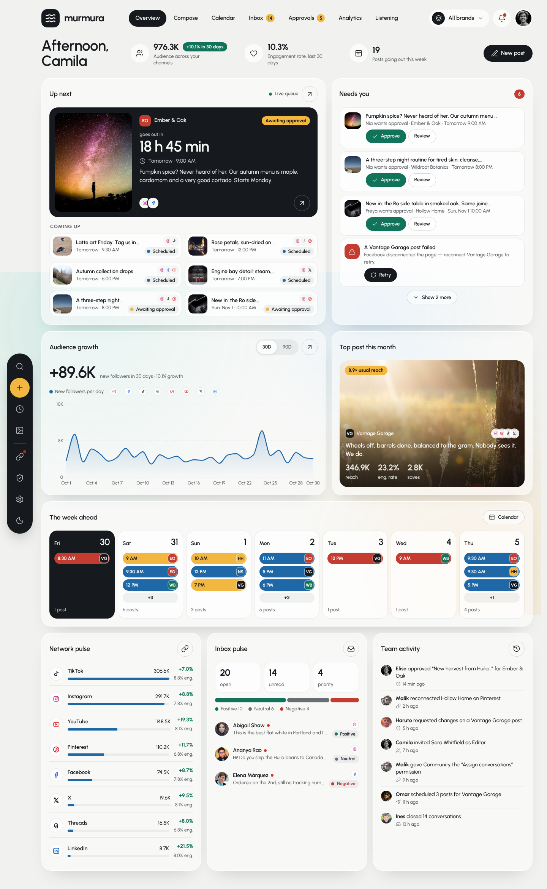 | 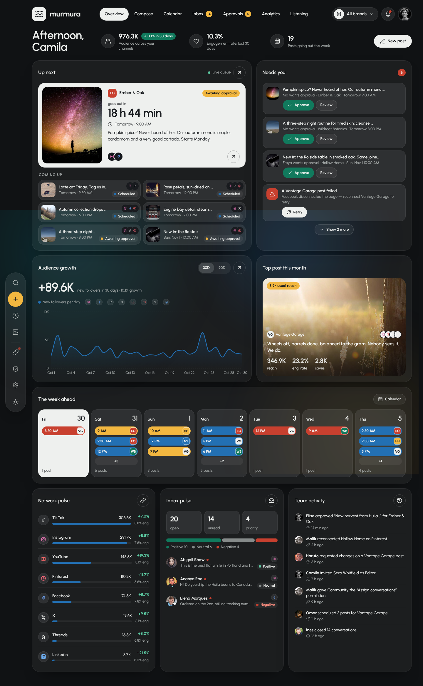 |

| Compose | Changes requested | Phone |
| --- | --- | --- |
|  |  | 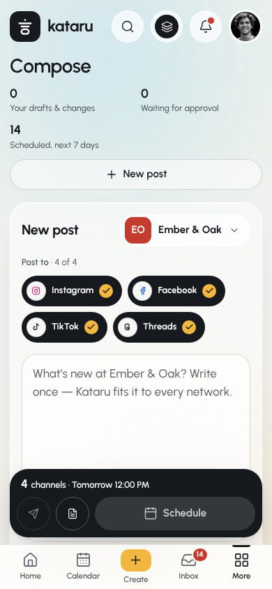 |

Compose writes a post once for a brand's channels: photos from the brand library
(numbered, reorderable), hashtag sets, templates and rule-based Assist rewrites
(shorter, friendlier, hashtags, call to action, spacing; undoable), character
dials per network, what still blocks it, first comment, a tagged link and a
campaign. The preview shows it the way each network lays it out; "When" suggests
the week's best times from the engagement heatmaps and the next slot that doesn't
crowd the brand's other posts. It schedules, publishes now, sends for approval
(depending on the role and the workspace rule) or saves a draft; posts sent back
with a note, waiting for approval, scheduled or published open with that context.

| Approvals | Request changes | Phone |
| --- | --- | --- |
|  |  |  |

Approvals lists what waits on you, everything pending, what was sent back, your
own submissions and what was approved in the last two weeks, per brand. Approve
one post (with Undo) or select several, send one back with a note (quick notes
help), or withdraw your own to drafts. Next to the queue: the rule in force, a
post's path, which roles need and give approval, and who approves each brand. The
overview's *Needs you* is built from the same data and acts in place: approve,
review in the drawer, retry a failed post, reconnect a channel.

| Calendar · Week | Month | List |
| --- | --- | --- |
| 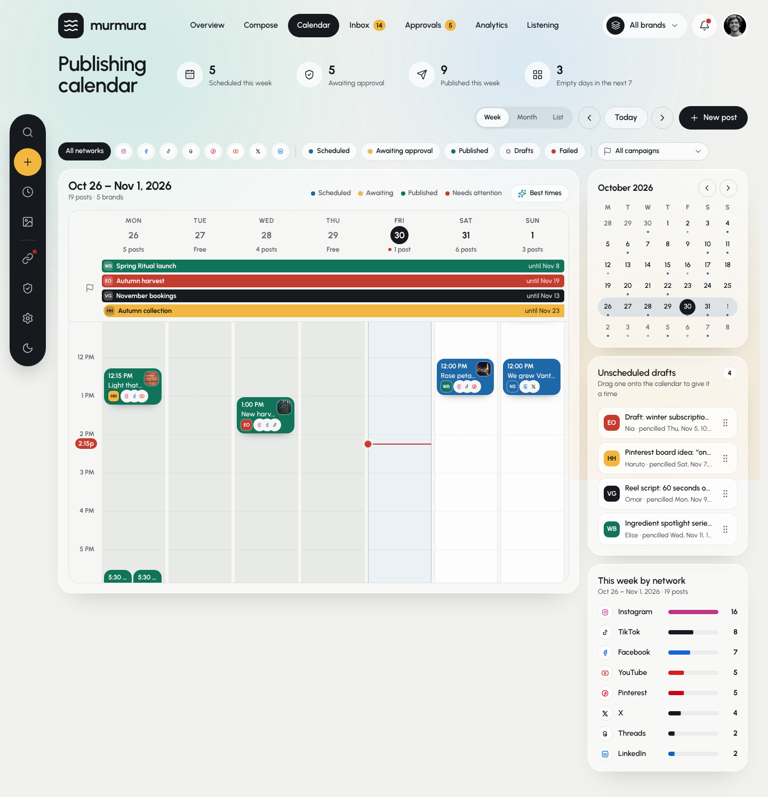 | 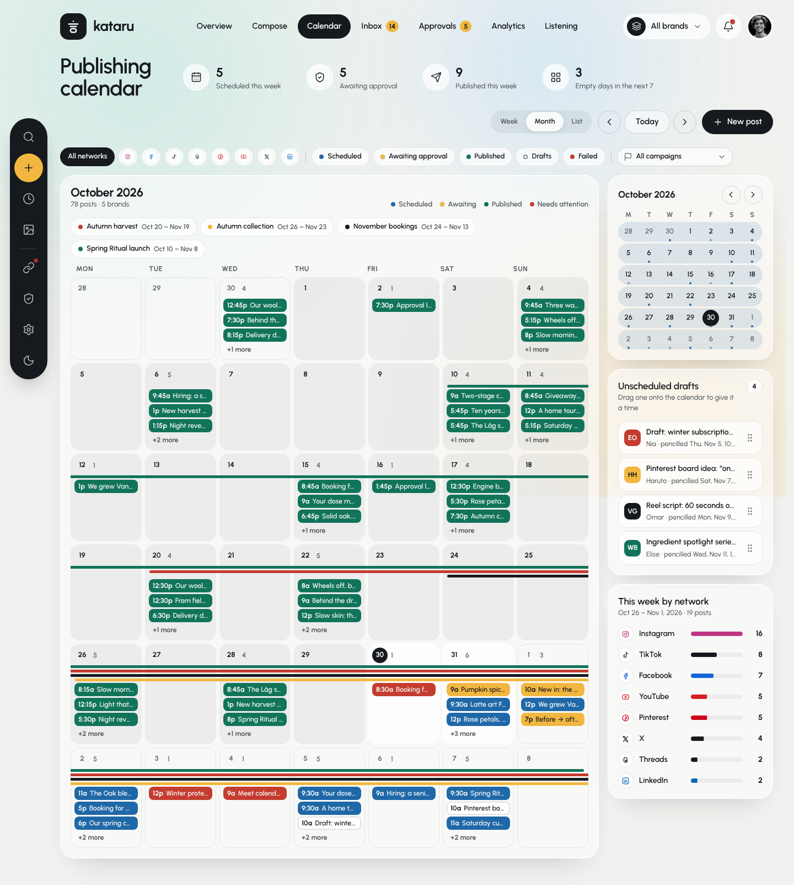 | 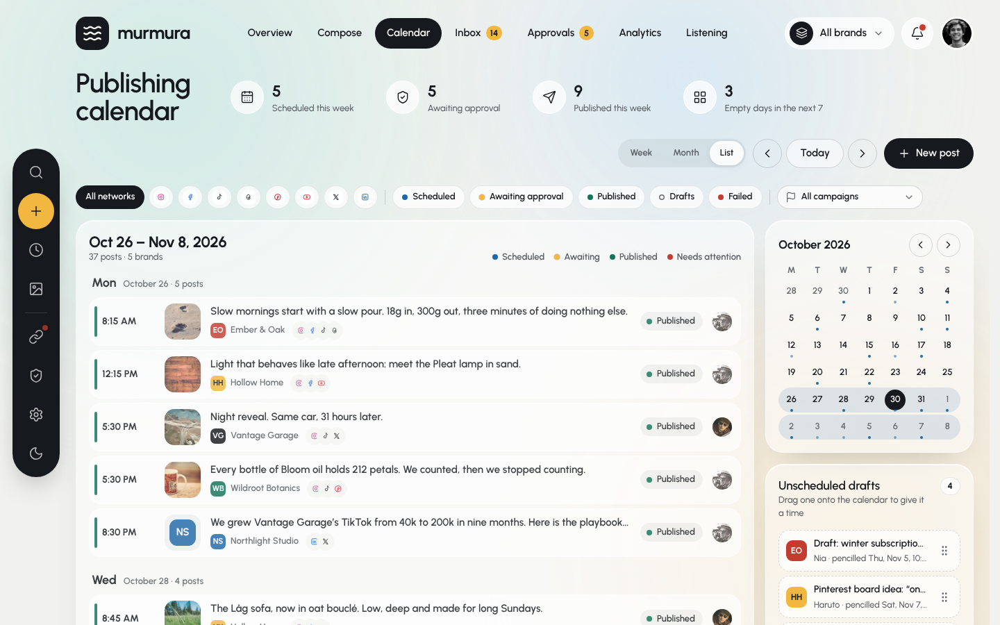 |

The week view supports drag & drop (posts and unscheduled drafts, 30-minute
snapping, Undo), `Alt` + arrow keys, a "Best times" heat overlay, filters by
network / status / campaign, and a post preview drawer.

| Inbox · Thread | Contact info | Saved replies | Dark |
| --- | --- | --- | --- |
| 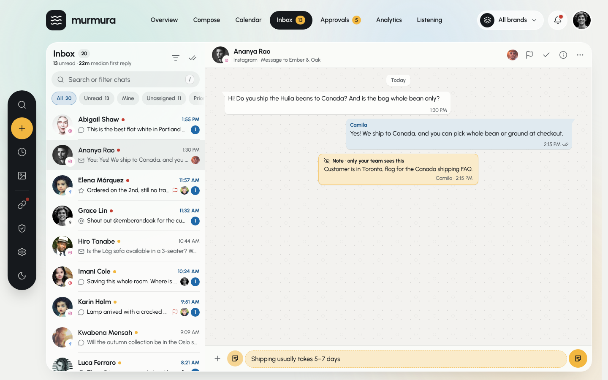 | 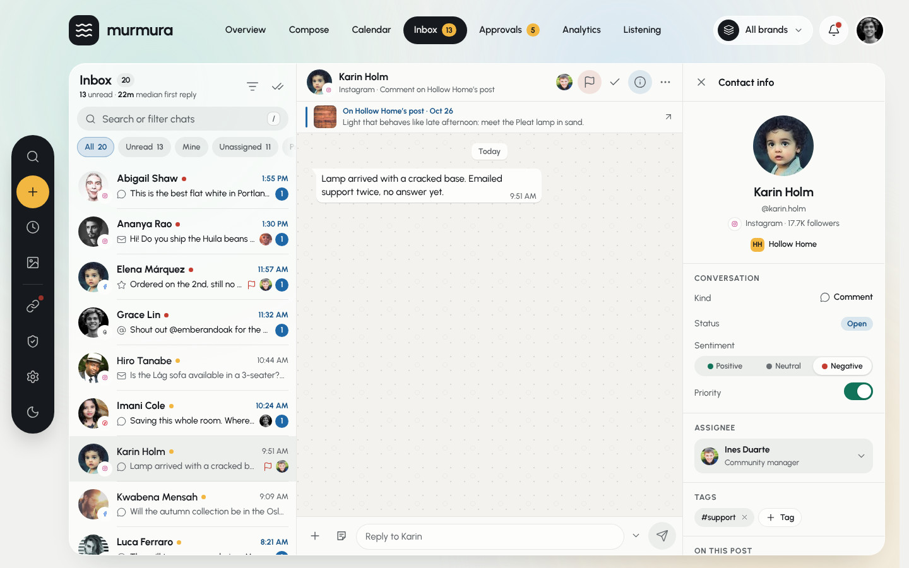 | 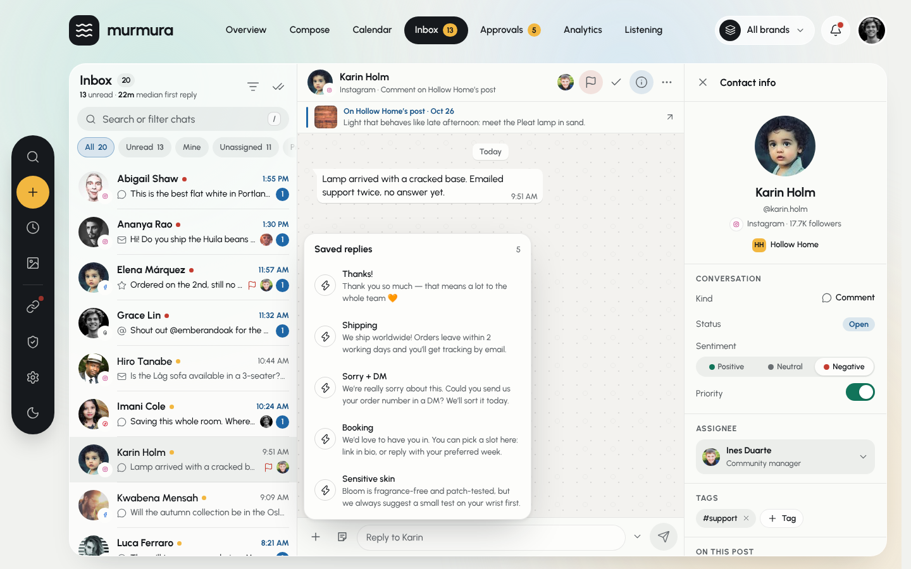 | 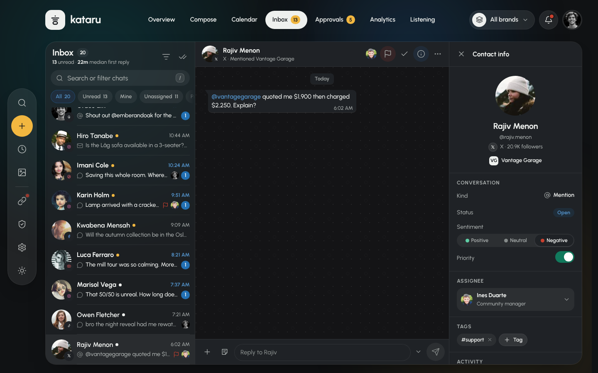 |

The inbox has views, search with highlighting, filters, replies, internal notes,
saved replies, photos from the brand library, assignment, priority, sentiment,
tags, J / K / E / R / `/` shortcuts and Undo on every change the original lets you undo.

| Analytics | Expanded card | Phone + More sheet |
| --- | --- | --- |
|  |  |  |

Analytics covers 7, 30 or 90 days for every network or one of them
(`#/analytics/instagram`): audience and impressions against the previous period,
a best-time heatmap, content mix, a sortable per-network / per-account table, top
posts (opening the post drawer) and a brand comparison. Every card expands over the
page; reports export as CSV or are scheduled by email (with Undo). On phones the
bottom bar's **More** sheet leads to it and to every other page.

Below the social cards, **Websites** adds Google Analytics 4: sessions, traffic
sources (social networks first) and landing pages for each brand's sites — a brand
can have several sites or none. It runs on demo data and reads real GA4 properties
once you connect an OAuth client; see [`docs/GOOGLE_ANALYTICS.md`](docs/GOOGLE_ANALYTICS.md).

| Websites (demo data) | Connect Google Analytics |
| --- | --- |
|  |  |

| Listening | Keyword + term filters | Phone |
| --- | --- | --- |
|  |  |  |

Listening follows tracked keywords (brands, hashtags, topics, competitors) across
the networks: a live stream of mentions (new ones arrive every 12 s) filtered by
keyword, sentiment, network, saved or a trending term; "Reply in inbox" turns a
mention into a conversation. Share of voice and the competitors table follow the
picked brand; sentiment over 14 days and a trending-terms cloud complete it. New
keywords backfill a few days of mentions; stopping or tracking one can be undone.

| Português (Portugal) · Visão geral | Calendário | Mensagens |
| --- | --- | --- |
| 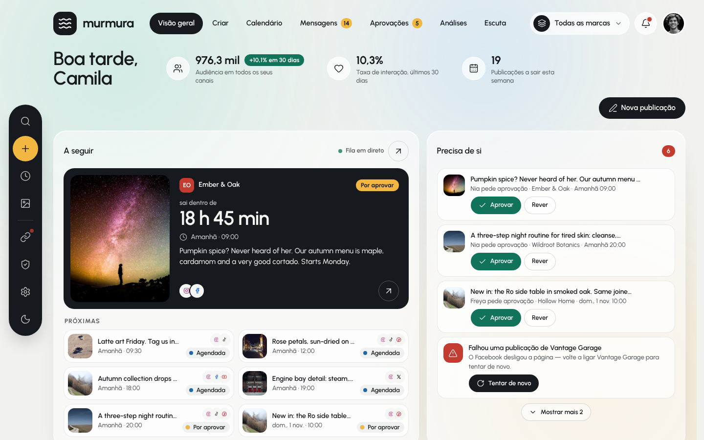 | 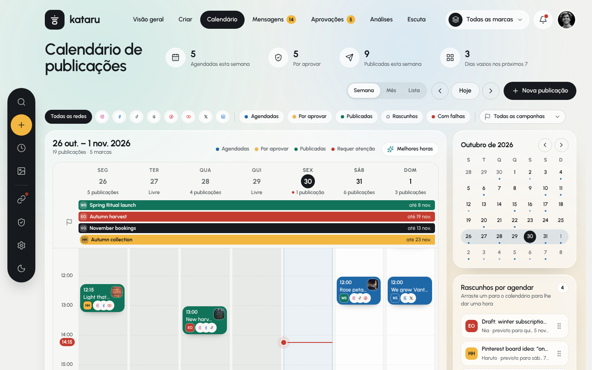 | 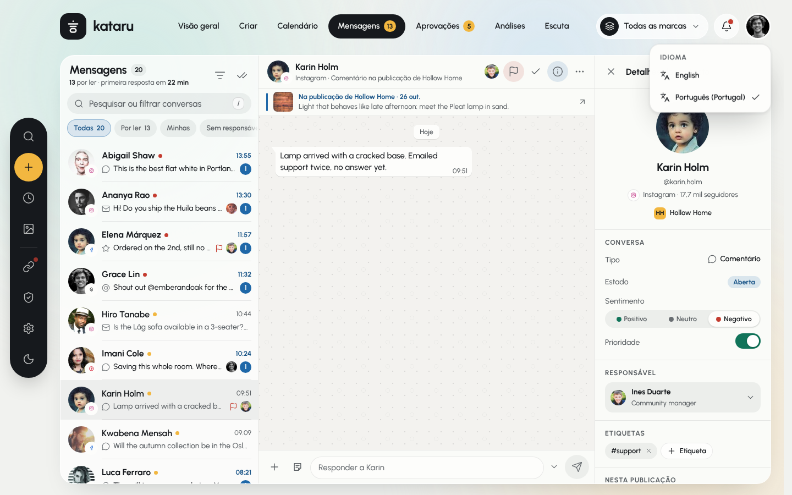 |

## Layout

```
src/
  index.css               design tokens (light + dark) mapped to Tailwind via @theme
  App.tsx                 providers, hash router, theme toggle, ticking mock clock
  i18n/
    en.tsx                English catalogue (source of truth, defines the Messages type)
    pt-PT.tsx             European Portuguese catalogue, type-checked against English
    format.ts             cached Intl formatters pinned to UTC
    index.tsx             I18nProvider, useI18n(), locale detection and persistence
  pages/
    Overview.tsx          #/overview: header + 8 cards on a 12-col grid
    Compose.tsx           #/compose/:id: draft state, route, notes, schedule / publish / approval / draft
    Approvals.tsx         #/approvals: stats, tabs, brand chips, cards, bulk approve, send back, withdraw
    Calendar.tsx          #/calendar: stats, filters, views, side panel, drawer wiring
    Inbox.tsx             #/inbox/:id: selection, actions + toasts, shortcuts, responsive panes
    Analytics.tsx         #/analytics/:network: stats, chips, expandable cards, table, top posts, brands, websites
    Listening.tsx         #/listening: stats, keywords, live stream, share of voice, cloud, sentiment, competitors
  components/
    AppShell.tsx          mesh background, top bar (sliding tab pill), dock, mobile nav + More sheet
    PageHead.tsx          letter-by-letter page title, header stat
    GrowthChart.tsx       SVG area chart: monotone curve, grid, crosshair, tooltip, ←/→ keys
    Toast.tsx             bottom toast with Undo or an action
    AuthoriseDialog.tsx   "Authorise on …": reconnects a channel (overview, channels)
    Popover.tsx           fixed popover anchored to its trigger (flips, clamps), menu rows
    Modal.tsx             <dialog> form shell (centred; a bottom sheet on phones) and a confirm dialog
    useScrollEdges.ts     edge fades for sideways scrollers on phones
    useMediaQuery.ts      live media-query match (phone layouts)
    usePostActions.ts     publish / duplicate / delete with Undo, shared by calendar and inbox
    ui.tsx                Card, Button, IconButton, Segmented, Badge, StatusPill, BrandMark, NetIcon…
    calendar/
      WeekView.tsx        time grid: sticky head + ribbons, lanes, now line, ghost, heat, drop target
      MonthView.tsx       6-week grid, campaign hairlines, chips, "+N more" popover
      ListView.tsx        two-week agenda
      SidePanel.tsx       mini calendar, unscheduled drafts, this week by network
      PostDrawer.tsx      <dialog> post preview with per-network mockups and actions
      useCalendarDrag.ts  pointer-based drag & drop with 30-min snapping
    analytics/
      parts.tsx           expandable card shell, figure, legend, empty state, filter chip, sortable header
      Websites.tsx        Websites (GA4): site chips, traffic, sources, landing pages
      Ga4Dialog.tsx       GA4 client ID + websites editor, connect / disconnect
      PeriodChart.tsx     this period vs the previous one: area + dashed line, nice axis, tooltip
      Heatmap.tsx         weekday × hour engagement grid, best slots, keyboard reading
      Sparkline.tsx       96×28 follower trend for table rows
      ReportControls.tsx  Schedule a report: form, report menu, stop with confirmation
      exportCsv.ts        CSV report in the reader's language
    compose/
      Editor.tsx          brand, channels, text box, photos, tools, Assist, dials, issues, more options
      Panels.tsx          preview, when (best times, day bar), publish bar, your drafts
      Pickers.tsx         library photos, hashtag sets, templates
    PostPreview.tsx       a post as each network lays it out (composer and post drawer)
    approvals/
      ApprovalCard.tsx    photo, badge, people, review history, actions, approved stamp
      Side.tsx            the rule in force, who approves, request-changes dialog
    listening/
      Keywords.tsx        tracked keywords: kind, brand, weekly count, 14-day line, sentiment split
      Stream.tsx          mentions: live toggle, filters, active chips, mention rows, paging
      Voice.tsx           brand picker, share of voice bars, competitors table
      Trending.tsx        trending-terms cloud
      SentimentChart.tsx  14-day positive / neutral / negative chart with tooltip
      TrackDialog.tsx     Track a keyword form
    inbox/
      ConversationList.tsx  head, search, views, filters popover, 72px rows, empty states
      Thread.tsx            header tools + menus, pinned post, message log, composer + popovers
      ContactInfo.tsx       contact panel: conversation, assignee, tags, post, activity
      TagPopover.tsx        "Add a tag" field with suggestions
  data/
    types.ts              Workspace schema (brands, campaigns, team, posts, channels, inbox, audit…)
    mock.ts               mock workspace frozen at Fri 30 Oct 2026, 14:15 UTC (80 posts, 19 channels, 6 websites, 22 conversations, 90 mentions)
    selectors.ts          overview view-model (worded through the active catalogue; Needs you derived from the data)
    calendar.ts           calendar date math, lanes, ribbons, filters, stats
    inbox.ts              inbox views, filters, search, unread counts, time labels, tag rules
    analytics.ts          analytics view-model: ranges, network filter, every figure on #/analytics
    analyticsData.ts      180 days per network, per-account totals and curves, heatmaps (from the reference)
    webAnalytics.ts       website traffic shape (GA4-like), demo generator, websites view model
    compose.ts            composer rules: network limits, issues, best times, free slot, links, Assist
    approvals.ts          approval queues, header figures, approve / send back / withdraw
    permissions.ts        roles, permissions, who approves and whose posts need approval
    postsData.ts          extra photos, campaigns, review trails per post (from the reference)
    listening.ts          listening view-model: stream filters, share of voice, cloud, sentiment, new mentions
    listeningData.ts      14 keywords, 90 mentions and 9 competitors (from the reference)
    ga4.ts                GA4 Data API from the browser: Google sign-in token, batchRunReports, mapping
    ga4Store.tsx          demo ↔ live switch, GA4 settings saved per browser
    store.tsx             shared store (posts, conversations, reports, keywords and mentions, with undo), saved per browser, reset
    persist.ts            saving and loading the workspace: version, seed fingerprint, mock clock
    routes.ts             the SPA's hash routes (their names live in the catalogues)
    assets.ts             image URL helpers (swap for real assets here)
```

Theme follows `html[data-theme]` and is toggled from the dock; the language follows
`html[lang]` and is picked from the account menu (both persisted per browser).
Every visible figure is computed from `mock.ts`, so editing the mock updates the
header stats, badges, week columns, meters and chart consistently.
