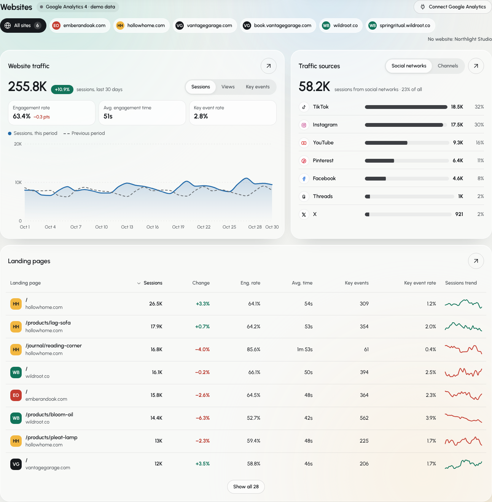
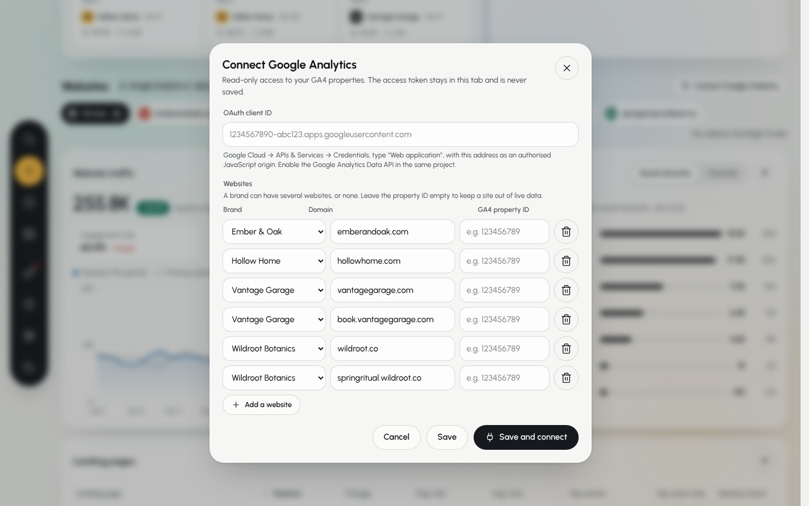

# Websites · Google Analytics 4

The analytics page (`#/analytics`) ends with a **Websites** section that is not
in the reference template: website traffic for every site or one of them, where
the visits come from (social networks first), and landing pages. It runs on
generated demo data until someone connects Google Analytics 4; then it reads the
real properties straight from the browser.

| Demo data | Connect Google Analytics |
| --- | --- |
|  |  |

## Websites belong to brands

Like social accounts, websites are owned by brands, and a brand can have **any
number of them, or none** (`Website` in `src/data/types.ts`). The mock workspace
has six: one each for Ember & Oak and Hollow Home, two for Vantage Garage
(the main site and its booking site) and two for Wildroot Botanics (the shop and
the Spring Ritual campaign microsite). Northlight Studio has none, which the
section says ("No website: Northlight Studio").

Sites are edited in the **Connect Google Analytics** dialog (**GA4 settings**
once connected): add or remove sites, move them between brands, and give each one
a GA4 property ID. The list and the client ID are saved in this browser
(`localStorage["kataru-ga4"]`, read from `murmura-ga4` when saved before the
rename); the access token never is.

## What the section shows

| Card | Contents |
| --- | --- |
| Header | data source (demo / live, last update), Refresh, GA4 settings or Connect |
| Site chips | All sites, then one chip per site with its brand mark; brands without a site and sites without data are listed on the right |
| Website traffic | sessions, views or key events for the page's 7D / 30D / 90D range against the range before; engagement rate (with the change in points), average engagement time and key event rate; the same period chart as the social cards |
| Traffic sources | sessions from social networks and their share of all sessions; per network (Instagram, TikTok…) or per default channel group (organic search, direct, organic social, referral, email, paid search…); the network picked in the page's chips is highlighted |
| Landing pages | page and site, sessions, change, engagement rate, average engagement time, key events, key event rate and a 7-day-average trend; sortable; 8 rows, "Show all" or Expand for the rest |

Rates are computed from sums so any range and any combination of sites adds up:
engagement rate = engaged sessions ÷ sessions, average engagement time = user
engagement duration ÷ sessions, key event rate = key events ÷ sessions. Users are
not shown because daily user counts can't be added up into a range.

## Demo data

`demoHistory()` in `src/data/webAnalytics.ts` generates 180 days per site,
deterministically (seeded), shaped to stay consistent with the rest of the app:

- **Social visits** are the brand's share, by followers, of each network's daily
  link clicks from the analytics series, 82% of which become sessions, split
  between the brand's sites. A brand only gets visits from networks it is on
  (Vantage Garage has no Pinterest account, so no Pinterest visits).
- **Campaign pages** (`/autumn-harvest`, `/collections/autumn`, `/november`,
  the Spring Ritual microsite) only draw traffic while their campaign runs, with a
  trickle afterwards; their sites get a lift during the campaign.
- Search, direct, referral, email and paid search follow a growing base with a
  weekly rhythm and a Tuesday newsletter peak.

## Connecting real data

You need, once:

1. A Google Cloud project with the **Google Analytics Data API** enabled.
2. An **OAuth consent screen** (internal for a Workspace organisation, or
   external in testing mode with your accounts added as test users).
3. An **OAuth client ID** of type **Web application** whose *Authorised
   JavaScript origins* include every address the app runs on, for example
   `http://localhost:5173` and your deployed origin. No redirect URI or client
   secret is needed.
4. **Viewer** (or higher) access to each GA4 property for the Google account that
   signs in.

Then open **Connect Google Analytics**, paste the client ID, put each site's
**property ID** (GA4 → Admin → Property details; a number such as `123456789`,
`properties/123456789` is accepted too) and press **Save and connect**. Google's
consent window asks for read-only Analytics access.

To ship a default client ID, build with it (see `.env.example`):

```bash
VITE_GA_CLIENT_ID=1234567890-abc.apps.googleusercontent.com npm run build
```

### What is requested

Sign-in uses Google Identity Services' token model with the
`https://www.googleapis.com/auth/analytics.readonly` scope. The token stays in
memory (about an hour); **Refresh** asks for a new one silently when it has
expired, **Disconnect** revokes it.

Each property costs one `properties/{id}:batchRunReports` call with four reports
over the last 180 days (`179daysAgo` → `today`):

| Report | Dimensions | Metrics |
| --- | --- | --- |
| Totals | `date` | `sessions`, `screenPageViews`, `engagedSessions`, `userEngagementDuration`, `keyEvents` |
| Channels | `date`, `sessionDefaultChannelGroup` | `sessions` |
| Social sources | `date`, `sessionSource` (only *Organic Social* and *Paid Social*) | `sessions` |
| Landing pages | `date`, `landingPage` (busiest first, top 25 kept) | `sessions`, `engagedSessions`, `userEngagementDuration`, `keyEvents` |

Sources are matched to networks by host or `utm_source`: `instagram`,
`l.instagram.com`, `facebook`, `m.facebook.com`, `lm.facebook.com`, `tiktok`,
`pinterest`, `pin.it`, `youtube`, `youtu.be`, `t.co`, `x.com`, `twitter`,
`linkedin`, `lnkd.in`, `threads.net`… Channel groups GA4 has beyond the ten listed
fold into "Other". Dates are lined up on the viewer's calendar day.

When connected, only sites with a property ID that loaded are shown; the others
are listed ("No GA4 property: …"), and a property that fails (no access, wrong ID,
expired session) is reported by name with Google's own explanation, without
hiding the sites that did load.

### Code

```
src/data/webAnalytics.ts   SiteHistory shape, demo generator, selectWebsites() view model
src/data/ga4.ts            Google Identity Services token, batchRunReports, response → SiteHistory
src/data/ga4Store.tsx      Ga4Provider / useGa4(): demo ↔ live, settings in localStorage, errors
src/components/analytics/Websites.tsx   the section (chips, traffic, sources, landing pages)
src/components/analytics/Ga4Dialog.tsx  client ID + websites editor, connect / disconnect
```

### How it was verified

There is no Google account in the build environment, so the live path was tested
end to end in the browser with Google's sign-in script and the Data API stubbed
by Playwright: one property answering with reports in the API's response format,
one answering 403. Checked: the client ID and read-only scope reach Google's token
client; one `batchRunReports` per property with the bearer token and the four
reports above; every figure on screen equals the fixture's arithmetic (sessions,
change, engagement, social share, channels, landing pages); the 403 is shown with
the site's name while the other site stays live; validation (missing client ID,
non-numeric property, empty domain); settings survive a reload while the token
does not; Disconnect revokes the token and returns to demo data. Real quotas and
Google's consent screen were not exercised.
