# Murmura · `#/overview`, `#/compose`, `#/calendar`, `#/inbox`, `#/analytics` + `#/listening` — reverse-engineering notes

Reference: `https://demo.codeandchill.store/murmura/#/overview`, inspected with the
Playwright MCP on **2026-10-30 ~14:15 UTC** at a **1440×900** viewport (light theme,
then dark). Method: accessibility snapshot with boxes → `getComputedStyle` on key
nodes → dump of every `cssRules` entry (custom properties + component rules) →
cleaned `outerHTML` per card → chart SVG paths decoded back into values → every
tab/dock/in-page link visited to map routes.

> The reference is a **paid template** (it carries a "Buy this template" link to
> Code and Chill). No source code, CSS or photography was copied: the recreation is
> written from scratch in React + Tailwind, network glyphs are redrawn, and images
> are seeded placeholders (`src/data/assets.ts`). Check the template's licence before
> shipping anything derived from its design commercially.

The recreation also runs in European Portuguese (the English shown and measured
here is unchanged); see [`I18N.md`](I18N.md).

The recreation is now called **Kataru**, with its own logo (see the README); this
document keeps the reference's name, Murmura, where it describes the reference.
The only visible differences the rename makes are the mark, the wordmark and the
document titles: the brand keeps the reference's width at ≥ 1341px, so every
measurement below still holds.

## 1. What the original is built with

| Aspect | Finding |
| --- | --- |
| App | Framework-less SPA, Vite build (`index-*.js`, lazy `overview-*.js` + `charts-*.js` chunks), CSS minified by lightningcss |
| Routing | Hash router, all views stay mounted and are toggled (`hidden`) |
| Theme | `html[data-theme="light" \| "dark"]`, every colour is a CSS custom property |
| Font | **Urbanist** 400–700 (Google Fonts, variable), body weight **500**, line-height **1.45** |
| Icons | Inline 24px stroke SVGs, `stroke-width: 1.7`, round caps/joins (Lucide-like) |
| Charts | Hand-rolled SVG (area + line, dashed grid, crosshair, HTML tooltip) |
| Motion | Letter-by-letter greeting, sliding tab pill (clip-path), count-up stats, breathing "live" dot, mesh parallax |

## 2. Design tokens

### Colour — light (`:root`) / dark (`:root[data-theme="dark"]`)

| Token | Light | Dark | Used for |
| --- | --- | --- | --- |
| `--bg` | `#f1f2ef` | `#101214` | page |
| `--mesh-a/b/c` | `#cde9e4` `#f3e3c8` `#d3e6f3` | `#0b7a874d` `#f2b7401f` `#1f68a84d` | blurred background blobs |
| `--glass` | `#ffffff85` | `#ffffff0d` | cards |
| `--glass-2` | `#ffffffb3` | `#ffffff16` | inner tiles, chips, icon buttons |
| `--glass-3` | `#ffffffdb` | `#212428` | hover, segmented pill |
| `--solid` | `#f6f7f4` | `#191b1f` | stack rings |
| `--float` | `#fdfdfb` | `#1f2226` | tooltips, popovers |
| `--well` | `#161a1e0f` | `#ffffff0f` | tracks, meters, status pills |
| `--line` / `--line-2` | `#161a1e17` / `#161a1e29` | `#ffffff14` / `#ffffff29` | hairlines / control borders |
| `--rim` | `#ffffffd1` | `#ffffff12` | card & glass borders |
| `--text` / `--muted` / `--faint` | `#16191d` / `#5b6064` / `#696e72` | `#eef0ee` / `#a6abaa` / `#868b8a` | type |
| `--butter` | `#f2b740` | — | awaiting approval, primary dock action, counts |
| `--pine` | `#11745a` | `#117a5d` | approve, positive, growth badge |
| `--coral` | `#c43c30` | `#c8402f` | failed / changes requested, alerts |
| `--sea` | `#1f68a8` | `#2370b3` | scheduled, chart series, meters |
| `--lilac` | `#0b7a87` | `#0a7582` | (unused on overview) |
| `--ink` / `--on-ink` | `#16191d` / `#f6f7f5` | `#eef0ee` / `#16191d` | hero tile, today column (inverts in dark) |
| `--pill` / `--dock` | `#16191d` | `#eef0ee` / `#ffffff14` | active tab, primary button / dock rail |
| `--good` / `--bad` / `--warn` | `#11745a` / `#b8382c` / `#855c00` | `#5fcfa6` / `#ff8f80` / `#e9c15a` | deltas & status text |
| `--n-instagram` … | `#c13584` `#1665d8` (fb) `#d61f1f` (yt) `#d0021b` (pin) `#0a66c2` (li), x/tiktok/threads = text | lighter tints | network glyph colours |

### Typography

| Token | Size | Where |
| --- | --- | --- |
| greeting | `clamp(30px, 2.7vw, 40px)` / 600 / lh 1.04 / ls −0.025em | `h1` (38.88px at 1440) |
| countdown | `clamp(30px, 2.8vw, 42px)` / 600 / lh 1 / ls −0.035em | hero |
| growth total | `clamp(32px, 3vw, 44px)` / 600 / ls −0.03em | Audience growth |
| `26px` 700 −0.02em | brand wordmark | |
| `24px` 600–700 −0.02em | day number, inbox counters | |
| `23px` 600 (`b` → bolder) −0.01em | header stats | |
| `22px` 700 −0.02em | top-post metrics | |
| `--fs-xl 20` `--fs-lg 18` `--fs-base 17` | card titles use **17/600/−0.005em** | |
| `--fs-md 16` | body, top-post caption (600) | |
| `--fs-sm 15` | tabs (600), buttons, hero caption | |
| `--fs-xs 14` | list titles (600), meta | |
| `--fs-2xs 13` | secondary text, labels, legend | |
| `12.5px` 700 | badges, chips, tab counts | |
| `12px` 500 | chart axis | |

Numbers use `font-variant-numeric: tabular-nums`.

### Radius, elevation, motion

| Token | Value |
| --- | --- |
| `--r-card` | 26px (cards) |
| `--r-tile` | 22px (hero, top post) |
| inner tiles | 20px (day), 18px (list items, todos), 16px (counters, hero media), 13–15px (thumbs, brand mark), 999px (controls) |
| `--shadow` | `0 1px 0 #ffffffbf inset, 0 24px 48px -30px #1e282d47` |
| `--shadow-pop` | `0 24px 60px -18px #14181c4d, 0 2px 6px #14181c14` |
| dock shadow | `0 20px 40px -18px rgba(0,0,0,.45)` |
| `--ease` | `cubic-bezier(.2, .8, .2, 1)` |
| mesh | blobs 62/70/46 vmax, `blur(60px)`, opacity .95 |

## 3. Layout & spacing

```
.app   padding: 22px  var(--gutter)  48px  calc(dock-x 18 + dock-w 68 + gutter)
       --gutter = clamp(16px, 1.6vw, 28px)   → 23.04px at 1440 → content x 109…1402
.top   grid [auto | 1fr | auto], gap 20, mb 26; tabs centred in the 1fr column
.head  flex-wrap, column gap clamp(28px, 4vw, 72px), row gap 18, mb 24
       stats gap clamp(24px, 3.2vw, 56px); New post pushed right (margin-left:auto)
.grid  12 columns, gap 16 (--gap)
       next 7 | needs 5
       growth 7 | top 5
       week 12
       nets 4 | inbox 4 | team 4
.card  padding 20, border 1px rim, head min-height 42 + margin-bottom 14
.dock  fixed, left 18, vertically centred, padding 8, gap 4, buttons 52 (48 when height ≤ 820)
```

| Breakpoint | Change |
| --- | --- |
| ≤ 1340px | tabs drop to a second row of the top bar |
| ≤ 1279px | grid → 2 columns: next / needs+growth / top / week / nets+inbox / team |
| ≤ 1000px | week strip scrolls horizontally with snap + fade mask |
| ≤ 860px | grid → 1 column |
| ≤ 760px | dock → bottom bar (64px + safe area), app padding 14px, brand switch icon-only |
| ≤ 600px | hero stacks (16:9 media), coming-up list 1 column |

## 4. Components (measured at 1440)

| Component | Spec |
| --- | --- |
| Brand | mark 48×48 r15 ink, wave glyph 28px stroke 2.1; wordmark 26/700 |
| Tabs | track padding 4, gap 2; tab padding 11×17, 15/600; ink pill slides (500ms ease); count badge 21px butter 12.5/700 |
| Brand switch | h46, glass-2 + rim, padding-left 6 / right 14, 34px ink disc with layers icon |
| Bell | 46px glass icon button, coral 9px dot at (9,10) with 2px bg ring |
| Account | 48px glass pill, avatar 42 |
| Dock | ink rail r999, buttons 52 r50% opacity .74 → 1 + `white/12` on hover; create = butter; channels has 8px coral dot; tooltip floats 14px right, float bg, shadow-pop |
| Stat | 48px glass disc + 20px icon; value 23/600; label 13 muted max-w 170 lh 1.3; growth badge pine |
| Button | h44 px19 15/600 r999 (sm: h36 px15 13px); ink / ghost (line-2 border, glass) / pine |
| Icon button | 42px, 1px line-2 border, arrow-up-right |
| Up next hero | ink tile r22, height clamp(250px, 20vw, 290px), columns `clamp(170px, 30%, 250px) 1fr`, gap 20, padding 14; 2-line clamp caption; networks 28px on-ink discs overlapping −6px |
| Coming up item | glass-2, line border, r18, padding 8, gap 11, thumb 50 r13, status pill (well bg + 8px dot) |
| Needs-you todo | glass-2 r18 padding 12, grid areas `ico txt / ico act`, gap 6×12; thumb 44 r13 or 40px coral icon tile |
| Segmented control | well track padding 3; button 8×15 13/600 muted; active glass-3 + `0 2px 8px rgba(0,0,0,.08)` |
| Growth chart | SVG 706×230; plot x 44→694, y 12 (10K) → 204 (0); dashed grid `3 4` line colour; line 2.5px sea; area sea 22% → 0; x labels every 3rd day (30D) / 9th (90D) + last |
| Tooltip | float bg, line border, r12, padding 8×11, 13px; centred 14px above the point |
| Top post | r22 photo, gradient `transparent 30% → rgba(10,10,12,.78)`, butter "8.9× usual reach" badge at 14/14, body padding 16 |
| Day column | glass-2 r20 padding 12 gap 10, min-h 172; today = ink; chips 12.5/700 r999 padding 4 4 4 9 tone-filled with 22px brand mark (ring white/50); max 3 + "+N" |
| Network row | 36px glyph disc · name/followers + 6px sea meter (scaled to the largest network) · delta (good) + engagement |
| Inbox pulse | 3 counters (glass-2 r16, 24/700), 12px sentiment bar split 3px, legend, rows with 36px avatar + unread 7px coral dot |
| Team feed | 28px avatar, 14px sentence with bold first name, 12.5 muted time with 13px kind icon, hairline separators |

## 5. Route map (SPA navigation)

| Route | Entry | View heading → sections |
| --- | --- | --- |
| `#/overview` | tab | Afternoon, Camila → Up next, Needs you, Audience growth, Top post this month, The week ahead, Network pulse, Inbox pulse, Team activity |
| `#/compose` | tab | Compose → New post, Preview, When, Your drafts |
| `#/calendar` | tab | Publishing calendar → Week/Month/List, Jump to a date, Unscheduled drafts, This week by network |
| `#/inbox` (badge = unread) | tab | Inbox → conversation list (views, search, filters), thread + composer, contact info |
| `#/approvals` (badge = awaiting) | tab | Approvals → Waiting for me · All pending · Changes requested · My submissions · Recently approved; The rule in force; Who approves |
| `#/analytics` | tab | Analytics → 7D/30D/90D; Audience growth, Impressions & engagement, Best time to post, Content mix, By network, Top posts, Brand comparison |
| `#/listening` | tab | Listening → Tracked keywords, Mentions, Share of voice, Trending terms, Sentiment over time, Competitors |
| `#/library` | dock | Library → Media, Templates, Hashtag sets, Saved replies |
| `#/channels` | dock (attention dot) | Channels → needs attention, one card per brand, Audience by network, Supported networks |
| `#/team` | dock | Team & roles → Members, Roles & permissions, Audit log |
| `#/settings` | dock | Settings → profile, notifications, workspace, approvals, security, billing, appearance, data |
| `#/inbox/:id` · `#/compose/:postId` · `#/analytics/:network` · `#/team/members` · `#/team/audit` · `#/settings/:section` | deep links | — |

Dock actions without a route: Search (⌘K), Create (N), Today's queue, Theme.
Encoded in `src/data/routes.ts`.

## 6. Data schema

Types live in `src/data/types.ts`, the mock in `src/data/mock.ts`, and every number
on the page is **derived** in `src/data/selectors.ts` (nothing is hard-coded in JSX):

| UI value | Derivation | Value |
| --- | --- | --- |
| Audience | Σ `channels[].followers` (19 accounts) | 976,260 → **976.3K** |
| +x% in 30 days | new followers in the last 30 days of `analytics.series` ÷ (audience − that) | 89,608 → **+10.1%** |
| Engagement rate | Σ engagements ÷ Σ reach of the posts published in the last 30 days | **10.3%** |
| Posts going out this week | non-draft posts in the calendar week (Mon–Sun) — the same 19 the calendar shows for Oct 26 – Nov 1 | **19** |
| Up next | soonest scheduled-or-awaiting post after `now`, then the next 6 | Ember & Oak · **18 h 45 min** |
| Needs you | `todos` (approvals, failed post, channel reconnects), 4 visible — derived from the data since §14 | **6** |
| 90D growth | Σ 90 points | **+238.9K · 32.4%** |
| Top post | published this month, max reach; "× usual reach" = its reach ÷ the median reach of the last 30 days' posts | 346.9K reach · 23.2% · 2.8K saves · 8.9× |
| Week ahead | posts per day, chip tone from status (sea scheduled, butter awaiting, coral failed/changes) | 1·6·3·5·1·1·4 |
| Network pulse | the analytics "By network" rows for 30 days (followers, growth, eng. rate); meter = followers ÷ max | TikTok 1 … LinkedIn 0.028 |
| Inbox pulse | open conversations; unread; priority; sentiment split | 20 · 14 · 4 · 10/6/4 |
| Tab badges | unread conversations / awaiting-approval posts | 14 / 5 |

The daily follower values were first recovered from the overview chart path
(`value = (204 − y) / 192 × 10 000`); they are now the sum of the per-network
analytics series (section 10), which reproduces them exactly.

## 7. Verification

Bounding boxes of 31 landmarks (title, tabs, stats, card headings, buttons, chart,
top post, dock, …) were measured on both pages at 1440×900: **all identical to the
pixel** (the greeting needed per-character spans, like the original, to lose
kerning and match its 177px width). The chart tooltip for the same pointer position
resolves to the same date, value and `translate(459.103px, 72.2864px)`. Axis labels
for 30D and 90D, the 90D totals, and the expanded "Needs you" list match verbatim.

Known differences:

- Photos and avatars are placeholders; brand/network glyphs are redrawn.
- Curve uses monotone-X interpolation; the original's smoothing differs slightly.
- The demo's live simulation (new inbox messages arriving, count-up stats, mesh
  parallax, magnetic buttons) is not reproduced; the countdown and "x min ago" do tick.
- `#/overview`, `#/compose`, `#/calendar`, `#/inbox`, `#/analytics` and `#/listening` are recreated; other routes render a placeholder listing their sections.

## 8. Calendar (`#/calendar`)

Reached from the **Calendar** tab of the top bar (the dock has no calendar link:
it holds Search, Create, Today's queue, Library, Channels, Team, Settings and
Theme), and from the "Open calendar" / "Calendar" shortcuts on the overview.
Inspected the same way (computed styles, the lazily loaded `calendar-*.css`
chunk, cleaned DOM per pane), plus every post read back from the List view
while paging Sep 28 → Nov 8.

### Layout

```
head      "Publishing calendar" + 4 stats; actions wrap to a 2nd row, right-aligned:
          Week/Month/List segmented · ‹ Today › (42px) · New post
.cl-bar   chips: All networks · 8 network chips (36px, icon only) | 5 status chips | campaign <select> (210px) · Clear
.cl-grid  [ calendar card (padding 18) | side 300px (330px ≥ 1500px) ], gap 16
          ≤ 1279px: one column, side cards 2-up, mini calendar hidden · ≤ 760px: filters scroll sideways
```

| Week grid (`.cl-wk`) | Value |
| --- | --- |
| Scroll box | `max-height: clamp(480px, 100dvh − 200px, 1040px)` (700px at 900px tall), `--solid` bg, r20, line border, opens 3 h above "now" |
| Columns | `var(--gut) repeat(7, minmax(var(--colw), 1fr))`, gap 6, right padding 8; gut/col 56/100 → 50/86 ≤1100 → 48/74 ≤900 |
| Hours | 6 AM → 11 PM, **72px** rows, labels 12.5/600 muted offset −9px; sticky left |
| Day head | sticky top: `MON` 12.5/700 +0.05em, 34px number disc (ink when today), "5 posts" / "Free", coral 6px dot when nothing live is booked |
| Campaign ribbons | sticky header subgrid rows of 24px (+4px gap), r999 (5px on edges cut by the week), 18px initials badge on `currentColor` 22%, "until Nov 8" hidden under 210px (container query) |
| Day column | `--glass-2`, r16; past = `--well`; today = sea 8% fill + sea 34% border; 18 dashed hour slots |
| Tile | `top: row·72 + 2`, height 68, lanes `left: 3px + (100% − 6px)·lane/lanes`, r14, padding 6/6/6/8, tone fill by status, 26px photo top-right; hides photo ≤92px, networks ≤84px, caption ≤58px |
| Now | 2px coral line across today's column with a pulsing 12px dot, coral "2:15p" pill in the gutter |
| Hover ghost | dashed glass pill "+ 3:30 PM", half-hour high, floor-snapped to 30 min, not on past days |
| Best times | lilac overlay per slot at `heat × .52` (.62 dark), staggered `ci·40ms + hi·10ms`, "Peak" pill when heat ≥ 0.9; legend swaps to a quiet → busy gradient |

| Month (`.cl-month`) / List (`.cl-list`) / side panel | Value |
| --- | --- |
| Month cell | min-h 134 (112 ≤900), r16, rim border; out-of-month transparent, past `--well`; 28px number button (ink today) + count; ≤3 chips (24px, r8, "9:45a" + caption) then "+N more" in the same 3px-gap grid |
| Month ribbons | 5px hairlines at top 39px, 3px apart; each cell's header gets `ribs × 8px` margin |
| List row | grid `76px 52px 1fr auto auto`, gap 14, r18, 4px status bar at left 7px, 52px thumb (brand mark when no photo), status pill, author avatar |
| Mini calendar | 6-week grid, 36px rows, 30px day discs, shaded visible range per week, 4px sea dot at opacity `.3 + min(3, n)·.23` |
| Drafts | dashed 1.5px card r16, 30px brand mark, "Nia · pencilled Thu, Nov 5, 10:00 AM", grip handle; draggable onto the grid |
| By network | rows `auto 84px 1fr 26px`, 28px glyph, 8px meter in the network colour, busiest first |
| Drawer | `<dialog>` fixed 12px from top/right/bottom, 480px, r28, `--glass-3`, blurred 26% backdrop; status, "Goes out Tomorrow · 9:30 AM · by …", per-network preview (feed / video / text-first), metrics once published, Publish now · Edit · Duplicate · Delete |

### Interactions

- **Drag & drop**: pointer events, a fixed clone follows the pointer with its time
  updating live; week columns snap the clone's top edge to 30 minutes, month cells
  keep the time of day. Target box: dashed ink border on butter 42% with a
  "Sat · 2:30 PM" label; past slots turn coral and are refused. Drop → toast
  "Moved to Tomorrow · 2:30 PM" + **Undo**, butter ring on the landed tile.
  Unscheduled drafts drag in from the side panel the same way.
- **Keyboard**: focused tile + `Alt` + `↑/↓` moves 30 min, `←/→` a day.
- **Filters** (networks, status groups, campaign) apply to all three views and the
  header counts; ribbons and month legend chips toggle the campaign filter.
- **Navigation**: ‹ › step a week (Week/List) or a month; mini calendar jumps;
  a month day number opens that week.

### Data

The 78 posts on the reference grid (Sep 28 – Nov 8: 50 published, 18 scheduled,
5 awaiting approval, 2 changes requested, 2 drafts, 1 failed) plus the two drafts
pencilled further out, 4 campaigns, and the 7×18 "best times" matrix were read
from the DOM into `src/data/mock.ts`. Derived values match the reference:
**5** scheduled / **5** awaiting / **9** published this week, **3** empty days in
the next 7, network load **16 · 8 · 7 · 5 · 5 · 4 · 2 · 2**, mini-calendar counts.
Calendar and overview share one store (`src/data/store.tsx`), so a post moved on
the calendar immediately reshuffles the overview's Up next and Week ahead.

### Verification (1440×900, week grid scroll aligned)

| Check | Result |
| --- | --- |
| 30 week-view landmarks (head, chips, select, grid, day heads, ribbons, columns, lane tiles, side cards) | identical to the pixel |
| Month view: 42 cells + 55 chips | identical |
| List view rows (first, today, last) | identical |
| Drawer box, title, timing line | identical (`933,12 480×876`) |
| Peaks with Best times on | same slots per day |
| Drag Sat 12 PM tile down 2.4 h | same "Sat · 2:30 PM" target and "Moved to Tomorrow · 2:30 PM" toast |

Known differences: the preview card's height follows the photo's aspect (the reference photos are
portrait, the placeholders square); the "Failed" chip groups failed and
changes-requested posts (the reference's "needs attention" colour); the reference
persists edits in `localStorage`, this recreation keeps them in memory.

## 9. Inbox (`#/inbox`)

Reached from the **Inbox** tab of the top bar (the dock has no inbox link either)
and from the overview's Inbox pulse. `#/inbox` opens the first conversation on
wide screens (`#/inbox/c1`); every conversation has its own deep link. Inspected
with computed styles and the lazily loaded `inbox-*.css` / `inbox-*.js` chunks
(read for behaviour only: toasts, menus, tag rules), cleaned DOM per pane, and the
22 conversations read back one by one.

### Layout

```
.ib-app   one card, h = max(560px, 100dvh − 120px)  (109,100 · 1293×780 at 1440×900)
          [ list clamp(300px, 27vw, 376px) | thread 1fr ]
          + contact info ≥ 1280px: [ list clamp(320px, 25vw, 376px) | thread | info 320px ]
          1000–1279px: info slides over the thread · ≤ 999px: list minmax(270px, 300px)
          ≤ 760px: one pane at a time (list ↔ thread by hash), info full screen
```

| List (`.ib-side`) | Value |
| --- | --- |
| Head | "Inbox" 21/700 −0.02em + count chip; "13 unread · 22m median first reply"; Filters (count badge) and Mark all read, 38px round buttons |
| Search | 36px pill, `--glass-2`, line-2 border, "/" key cap (12.5/600, r8; hidden on touch) |
| Views | 32px chips with counts: All 20 · Unread 13 · Mine · Unassigned 11 · Priority 4 · Done 2 (sideways scroll) |
| Row | **72px**, `48px 1fr` grid, gap 13; 48px face + 20px network badge (`--float` ring); name 16 (600, 800 while unread), brand dot, time (accent while unread); kind glyph 15px, preview of the last non-note message ("You:" / "Note:" / "Photo"), priority flag, 20px assignee, 21px unread disc; current row `--well` |
| Faces | photo, or initials on one of four tints (`#f4dba8 #cde8de #f3cdbf #cfe3f1`, Σ char codes mod 4) for the five Wildroot contacts without a photo |

| Thread (`.ib-th`) | Value |
| --- | --- |
| Head | 60px; 40px face, name 16/700, "Instagram · Comment on Ember & Oak’s post"; 38px tools: assign (26px avatar, "Assigned to Haruto Sato — reassign"), priority (coral when on), done (E) / reopen, info (pressed), more |
| Pin bar | 50px, 3px sea rule, 36px thumb, "On Ember & Oak’s post · Oct 28" 12.5/700 accent + caption; opens the post drawer |
| Wall | `--ib-wall` with a 22px dot grid, sticky day pills ("Today", "Yesterday", weekday, "Oct 3") 12.5/600 on `--float` |
| Bubble | max `min(65%, 560px)`, r9, padding 6/9/7, 15px/1.38; 8×12 clip-path tail on the first of a run (gap 10, else 2); theirs `--float`, ours `--ib-us` with the sender's first name 12.5/700 accent; time + ✓✓ (accent once read) bottom-right, an inline 66/84px spacer keeps text clear of it; `#tags`, `@handles`, links 600 accent |
| Note | centred, `min(78%, 440px)`, r10, `--ib-note` + `--ib-note-rim`, "Note · only your team sees this", "Camila · 5:13 PM" |
| Composer | Attach + Internal note (38px), pill input r22 growing 21 → 121px (dashed butter in note mode, "Note for the team…"), 30px caret (opens only with something to send), 44px send (sea; note mode swaps in the note glyph, "Add note") |

| Contact info (`.ib-info`, 320px) / popovers | Value |
| --- | --- |
| Hero | 96px face, name 20/700, @handle, network · followers, brand chip |
| Sections | padding 14/18, uppercase 12.5/700 headings; rows ≥ 30px, gap 10: Kind, Status pill, Sentiment (3 segments, 32px), Priority switch 46×28 |
| Assignee / Tags / Post / Activity | `--well` button with 28px avatar + job title; 30px tag chips with × and "+ Tag"; 72px thumb + first line (90 chars); messages "n · x in · y out", first contact, last message; footer Mark done (pine) / Reopen |
| `.pop` | r18, 6px padding, 210 → `min(380px, 100vw − 24px)`, 8px from its trigger, flips when there's no room, clamped to the viewport |
| Menus | 46px rows (18px glyph, gap 10), separators 1px with 4/6 margins, check mark on the selected radio item |
| Sizes | Filters 288 (Kind / Network / Sentiment with counts; Clear at 45% until something is ticked), Attach 210, Saved replies 360 (5 replies, 34px bolt), Choose a photo 360 (3-col grid), Add a tag 314 (42px "#" field, ≤ 10 suggestions) |

### Interactions

- Opening a conversation reads it; the unread disc counts inbound messages since
  our last reply. J / K move, E closes (stamp, then the next row), R focuses the
  composer, "/" the search; Enter sends, Shift+Enter breaks the line, ⌘⇧Enter sends
  and closes.
- Toasts mirror the reference, with Undo where it has one: "Done · Abigail’s
  comment closed", "Reopened …", "Sent to Abigail · conversation closed",
  "Marked 13 as read", "Marked as priority" / "Priority removed", "Marked
  positive", "Removed #press", "Tagged #press" (only while the contact panel is
  closed), "Marked as unread". Assigning confirms in place, with no toast.
- "Mark as unread" also leaves the conversation and parks the inbox on its empty
  state instead of reopening the first row.
- Search matches name, handle, tags and message text, highlighting hits; views and
  filters combine, each with its own empty state.
- The assign menu lists you, then teammates with access to the conversation's
  brand (team order, titles and brand access taken from the reference).
- Tags are normalised like the reference (`#`, lowercase, spaces → `-`, `[a-z0-9-]`,
  24 chars); suggestions are the workspace's tags, then support, sales, shipping,
  refund, wholesale, press, ugc, question, vip.

### Data

22 conversations (20 open, 2 done) with every message, author, minute offset,
sentiment, tag and assignee read from the reference into `src/data/mock.ts`,
plus 5 saved replies and each brand's media library (25 titled photos). Derived
values match: **13** unread after the first conversation opens (14 on the tab
badge before), **11** unassigned, **4** priority, kinds **11 · 5 · 3 · 1**,
networks **8 · 2 · 1 · 2 · 2 · 1 · 2 · 2**, sentiment **10 · 6 · 4**, median first
reply **22m**. The inbox shares the workspace store with the overview, so replying
or marking read updates the Inbox pulse and the tab badge immediately.

### Verification (1440×900)

| Check | Result |
| --- | --- |
| List head, search, view chips, 3 rows, thread head, pin bar, bubble, composer (92 landmarks) | identical to the pixel |
| Contact info open on c5 / c8 / c18 (42–48 landmarks each, incl. initials avatar) | identical |
| Attach, More, Assign menus: position and every item | identical |
| Filters (288×524), Saved replies (360 wide), Choose a photo grid, Add a tag chips | identical |
| Dark theme and the mobile thread view | visually matched |
| Overview / calendar after the change | unchanged (calendar differs only by grid scroll, which follows the clock) |

Known differences: the reference's live simulation (new comments every minute with
a "New comment from … on Instagram" toast) is not reproduced and times come from
the frozen clock; photos are placeholders; assignee notifications, the audit log
and role-based locks ("Your role can’t reply") are not modelled because the mock
user is the owner; the phone header and bottom bar were aligned with the reference later,
with the analytics work (section 10).

## 10. Analytics (`#/analytics`)

Reached from the **Analytics** tab, and on phones from the bottom bar's **More**
sheet (recreated too). `#/analytics/:network` filters the whole page to one
network. Inspected with computed styles, the page's lazily loaded `analytics-*`
CSS and JS (read for behaviour and wording only), every chart path, table cell
and heatmap opacity for **27 states** (7D/30D/90D × all networks + 8 networks),
and the reference's own state (19 channels, 89 posts with their metrics).

| Analytics · 1440 | Expanded card + heatmap tooltip | Phone + More sheet |
| --- | --- | --- |
|  |  |  |

| Instagram filter, dark | Schedule a report (pt-PT) |
| --- | --- |
|  |  |

### Layout

```
header   title · 4 stats (users, trending-up, eye, heart) · 7D/30D/90D · Export CSV (ink) · Schedule a report (ghost)
chips    All networks 19 · Instagram 4 · Facebook 3 · X 2 · LinkedIn 1 · TikTok 3 · YouTube 2 · Pinterest 2 · Threads 2   "5 brands · last 30 days"
.an-grid 12 cols, gap 16:  grow 7 | imp 5  /  best 8 | mix 4  /  net 12  /  top 7 | brands 5
         ≤ 1340px: 6 cols (grow 3 | imp 3 / best 6 / mix 3 | brands 3 / net 6 / top 6) · ≤ 1000px: 1 col
```

| Part | Value |
| --- | --- |
| Chip | 38px pill, padding 0 12 0 6, gap 8, 13/600; 22px network disc on `--solid`; count 20px pill on `--well`; current = `--pill` (count and disc 14–16% white) |
| Card | the overview card (26px radius, 20px padding, 16px on phones) + an **Expand** button: the card lifts out over a 28% scrim, `width: min(1165px, 92%)`, `top: 8vh`, `max-height: 84vh` (10px inset on phones), Escape or the scrim closes it, a dashed outline keeps its place |
| Figures | `clamp(28px, 2.5vw, 36px)`/600, caption 13px muted on the same baseline; delta badge pine / coral |
| Charts | viewBox `width × 240`, plot x 44 → width − 12, y 12 → 214; this period 2.5px line + 22% → 0 area, previous period 2px `--faint` dashed 5/6; ticks 0 · top/2 · top with **top = smallest 1/2/2.5/5 × 10ⁿ ≥ 1.08 × max** (checked on 108 axes); one date per ~60px of plot plus the last day; crosshair + two 4.5px dots, tooltip "Oct 15 / This period 44.8K / Previous period 39.1K" |
| Heatmap | `36px repeat(24, 1fr)`, gap 4 (3 on phones), min-width 600 (560); cell r7 on `--well` with a `--sea` layer at opacity = value (`#3f8fd6` in dark); best 3 ringed (inset −4, r10, 2px) with a 19px rank disc; hours 12a 3a … 9p; Quiet ▭ Busy (96×10); slots: 26px rank, "Sat 8 AM / index 100", 34px plan button |
| Content mix | rows `auto 7.5em 1fr auto 3.2em`, gap 10, 28px disc, 10px meter (ink at 82%), count, % |
| Table | header 13/600 muted with sort buttons (chevron, shown on hover, flipped when ascending); rows 60px: 36px disc / 38px brand mark + name + "3 accounts" / handle, Status pill on the account view, growth pine/coral bold, 96×28 sparkline; phones: one 3-column card per row with labelled cells |
| Top posts | `repeat(auto-fill, minmax(200px, 1fr))` gap 12 (2 columns on phones); card r20, image 1 / 0.86 (text-only posts on a wash of the brand colour), rank 30px (#1 butter), net stack, value 22/700, unit, brand chip + date, 👁 impressions · ♡ engagements |
| Brand comparison | rows `auto 9em 1fr 4.4em`, 38px mark, "5 accounts · 11 posts", 14px track; phones move the bar under the name |
| More sheet | bottom `<dialog>`, 28px top radius, `--solid`, handle, 44px close; 2-col 58px tiles (36px icon box, current = ink), Approvals count; Search · Today · Dark/Light |

### How every figure is computed (`src/data/analytics.ts`)

| Figure | Rule |
| --- | --- |
| Audience | Σ followers of the accounts in view ("across 19 accounts") |
| New followers / badge | Σ daily gains over the range; badge = gained ÷ (audience − gained) |
| vs the days before | (gained − gained in the previous range) ÷ previous ("no earlier period" when 0) |
| Impressions / engagements / link clicks | Σ of the daily series; delta against the previous range |
| Avg. engagement rate, N posts | mean of (likes + comments + shares + saves) ÷ reach over published posts with reach, `now − range ≤ at < now`, sent to the network in view |
| Content mix | network deliveries of those posts, most first, ties in the order they first went out; % = count ÷ deliveries |
| By network | per network: accounts, Σ followers, growth = gains ÷ (followers − gains), Σ impressions, mean eng. rate and count of its posts, follower curve |
| Accounts (network picked) | per channel: its own gains and impressions, the brand's posts on that network ("—" without posts) |
| Top posts | the range's posts, ranked by reach, engagement rate or link clicks; first 6 |
| Brand comparison | per brand in view: Σ followers ("—" without accounts), mean eng. rate, Σ impressions; ties keep brand order |
| Best time to post | 168 values per network (range-independent); top 3 by value, index = round(value × 100) |

Data: the 19 channels (followers, status, handle) and the real metrics of the 50
published posts come from the reference state; `src/data/analyticsData.ts` holds
180 days of followers / impressions / engagements / clicks per network (decoded
from the chart paths; all-networks = Σ networks, exactly), per-account range
totals (solved inside the rounding interval of every printed cell, so the 57
account rows, 15 brand totals and every growth % print the same), follower curves
and heatmaps. The overview now derives its audience, growth, engagement rate,
network pulse and top-post multiplier from the same data, with identical output.

### Interactions

- Range, network chips (and their deep links), metric, ranking and comparison toggles;
  the heatmap has its own network switch that follows the page filter.
- Sortable table (first click: name ascending, numbers descending); clicking a
  network row opens that network; "← All networks" goes back.
- Hover or arrow keys on the heatmap (a live region reads the hour aloud); hover or
  ←/→ on the charts. Plan buttons go to Compose, like the calendar's slots.
- Top post cards open the calendar's post drawer (publish, duplicate, delete, Undo).
- **Export CSV** downloads `kataru-analytics-30d[-network].csv`: scope, period,
  summary, the daily series, the table and every post (pt-PT uses `;` and decimal commas).
- **Schedule a report**: name, Weekly (Mondays 9:00) / Monthly (1st, 9:00), recipients
  (you preselected, "Pick at least one recipient."), toast with the first send and
  Undo; afterwards the button shows a count and opens a menu of reports, each one
  stoppable after a confirmation ("Stop this report?" → "Report stopped", Undo).

### Verification

| Check | Result |
| --- | --- |
| 22 landmarks (7 cards, chips, stats, actions, charts, heatmap, table, posts, bars…) at **1440**, **1280**, **1000** and **390** px | identical to the pixel; page height 2797 / 3468 / 4329 / 5505, as in the reference |
| Same at 390 px with a touch pointer (44px targets) | within 1px |
| Every printed figure in 27 states: stats, chips, note, both charts' texts, ticks and date labels (all three metrics), heatmap label + cells + slots, mix rows + meters, table cells + links, 6 top posts × 3 rankings, brands × 3 metrics + bars | identical, except bar lengths in brand impressions (≤ 0.0002) and "1 post / 1 delivery" (the reference prints "1 posts / 1 deliveries") |
| Expanded card | `130,72 1165×413` at 1440 (same), x labels every 2 days |
| Dark theme, mobile More sheet | visually matched |
| English text of the other pages | unchanged apart from the new phone controls and the placeholder's route list |

Known differences: the reference animates figures (count-up, morphing lines,
FLIP expansion), and its scheduled reports and CSV export run on the same mock
data; recipients are the 8 team members of this workspace (the reference also
lists an analyst and two client logins); role locks ("Your role can't export
reports") are not modelled because the mock user is the owner.

## 11. Websites · Google Analytics 4 (addition)

Not in the reference: requested on top of the recreation. The Websites section
under the analytics cards is built only from the reference's own parts (expandable
cards, 38px chips, the period chart, mix rows, the sortable table and its phone
card layout), so it reads as the same product, and it is placed after the
reference cards so the measured layout above stays identical (every landmark of
section 10 still matches at 1440 and 390 px; the page is longer). Websites are
owned by brands like social accounts — several, one or none per brand. Data
model, demo generation, the live GA4 connection and how it was tested are in
[`GOOGLE_ANALYTICS.md`](GOOGLE_ANALYTICS.md).

## 12. Listening (`#/listening`)

Reached from the **Listening** tab, and on phones from the bottom bar's **More**
sheet. Inspected the same way as analytics: computed styles at 1440 / 1280 / 960 /
390 px (touch pointer on the phone), the page's lazily loaded `listening-*` CSS and
JS (read for behaviour and wording only), every chart path, and the reference's own
state (14 keywords, 90 mentions, 9 competitors) read from its `localStorage` with the
clock pinned to Fri 30 Oct 2026, 14:15 UTC.

| Listening · 1440 | Keyword + term filters | Phone |
| --- | --- | --- |
|  |  |  |

| Track a keyword | Dark | Escuta (pt-PT) |
| --- | --- | --- |
|  |  |  |

### Layout

```
header   title · 4 stats (message, smile, eye, pie) · Track a keyword (ink)
.ls-grid 12 cols, gap 16, rows auto 1fr auto:
           kw 4 | stream 5 | share of voice 3
           kw   | stream   | trending terms 3
           sentiment 7 | competitors 5
         ≤ 1340px: 6 cols (kw 3 | stream 3 / sov 3 | trending 3 / sentiment 6 / competitors 6)
         ≤ 1000px: 1 col, the stream first
```

| Part | Value |
| --- | --- |
| Keyword row | r18, padding 8 8 10, `1fr auto` with a 34px remove button over both rows; selected = `--glass-2` + `--line-2` border; kind badge min-width 84 (Brand ink, Hashtag sea, Topic pine, Competitor coral); term 15/700 + 16px brand mark and "9 this week"; 92×30 sea line of 14 days with a 3.2px end dot; 6px sentiment split (good / line-2 / coral, 2px gaps) indented 96px. Phones: badge on its own line, 72px line, 6 rows until "Show all keywords 14" |
| Stream filters | segmented All / Positive / Neutral / Negative (full width on phones), 34px chips "All networks" (menu) and "Saved n", butter chips for the active keyword / term |
| Live | 34px pill, `--well` → coral 14% with a 9px dot beating at 1.6s |
| Mention | `auto 1fr`, gap 12, padding 14 4, hairline; 36px face + 20px network disc; name 15/700, "@handle · 45 min ago", sentiment pill (13px, 27px tall); text 16/1.45 with the keyword (or the searched term) in a butter `<mark>`; footer 12.5px: kind dot + keyword, reach, Reply in inbox (36px) · Save (34px, butter when on) · Hide. 8 per page (6 on phones), "Show 8 more 82" |
| Share of voice | brand picker chip (34px), `clamp(28px, 2.5vw, 36px)` figure, rows `auto 1fr 3.2em`: 30px mark, name (+ ink "You" pill), %, 10px track filled to share ÷ loudest (brand ink, competitors `--faint`) |
| Trending terms | centred wrap, gap 6 8; pills padding 4 11, sizes 13 (muted) / 15 / 18 / 22 / 27 px bold; keywords outlined on `--glass-2`; picked = ink |
| Sentiment chart | viewBox `width × 230`, plot x 44 → width − 12, y 12 → 204; positive 2.5px pine over a 22% area, neutral muted and negative coral 2px; one date label per ≥ 60px of plot, the one before the last dropped within 40px of it; tooltip with the three counts |
| Competitors | table 14px, header 13/600; rows 60px with a 38px mark, name 14/600 and handle 13px; "You" row on `--well` with 14px rounded ends; growth pine / coral bold. Names are never truncated: like the reference, the table scrolls sideways when the card is narrower (its last cell's padding at 1440) |
| Touch | 44px Live pill, chips, small buttons, keyword rows and cloud terms; 46px menu rows |

### How every figure is computed (`src/data/listening.ts`)

| Figure | Rule |
| --- | --- |
| This week | a rolling week: mentions from the last 7 × 24 h |
| Mentions · net sentiment · potential reach | count; (positive − negative) ÷ count; Σ reach |
| Share of voice | for the picked brand: its own keywords' mentions this week (competitor keywords excluded) against each competitor's baseline + the mentions of a competitor keyword with its name. Ember & Oak 19 · Stumptown 28 + 5 · Heart Roasters 26 · Coava 18 → 20 / 34 / 27 / 19 % |
| Keyword row | count this week; split = shares of all its mentions; line = the week before (stored per keyword) + this week's mentions per calendar day |
| Sentiment over time | 14 calendar days; this week counted from the mentions, the week before from each keyword's stored volume split like its mentions (positive and negative rounded, neutral the rest); caption = net this week vs the week before in points (39 % · −8 pts) |
| Trending terms | each keyword with its mentions this week, plus hashtags that aren't keywords and words of 4+ letters that aren't filler or part of a keyword (words need 2 mentions), from this week's mentions newest first; the 22 busiest; type size 1 + round((n − min) ÷ (max − min) × 4); even ranks keep their place and odd ranks fill in from the quiet end, so big and small alternate |
| You (competitors) | Σ followers of the brand's accounts; growth = 30-day gains ÷ (followers − gains); engagement = mean rate of its posts published in the last 28 days; posts / wk = that count ÷ 4 → 142.7K · +8.5 % · 9.2 % · 2.5 |
| Mention text | the post's text, led by "Keyword — " when the text doesn't contain the keyword |

Data (`src/data/listeningData.ts`): the 14 keywords with the week before as 7
daily values (decoded from the reference's sparklines), the 90 mentions as minutes
before "now", and the 9 competitors. All 14 lines, the 42 sentiment points, the
cloud (terms, counts, sizes and order), every stat and both tables were checked
against the reference: identical. People who also write to the inbox keep the
same placeholder photo in both places.

### Interactions

- A keyword row or a keyword in the cloud filters the stream to it; any other term
  searches the stream (and marks it), scrolling the stream into view; butter chips
  clear them, "Clear filters" clears everything.
- Sentiment, network menu and Saved filters; "Show N more" pages by 8 (6 on phones);
  "That's every mention in view." once all are listed.
- **Live**: every 12 s while the page is visible a new mention of a random keyword
  arrives on top, lit up; pausing / resuming says so in a toast.
- **Save** (star) and **Hide** (with Undo).
- **Reply in inbox** opens a conversation with the author for the keyword's brand
  (from its account on that network, else its first connected one), with the
  mention as the first message, `#listening` tag, priority when negative; logs
  "opened a conversation from an Instagram mention of “…”" in the team activity,
  toasts "Moved to the inbox · Northlight Studio" and goes to `#/inbox/:id`. The
  button then reads "Open in inbox".
- **Track a keyword**: term (hashtags get their `#` and lose spaces), kind, brand;
  "That keyword is too short to listen for.", "Ember & Oak already tracks “…”.";
  backfills 3 mentions (3 h, 29 h and 55 h ago) and toasts with Undo. **Stop
  tracking** (×) removes the keyword and its mentions, Undo puts both back in place.
  Both are logged in the team activity.
- Every card expands over the page like the analytics cards.

### Verification

| Check | Result |
| --- | --- |
| 43 landmarks (header, 6 cards, keyword row parts, filters, 3 mentions and their parts, share-of-voice rows, cloud terms, chart, table rows and headers) at **1440**, **1280**, **960** and **390** px (touch) | identical to the pixel; page heights the same |
| Chart date labels at the four widths | identical |
| Seed data replayed through the rules above | the reference's sparklines, sentiment series, cloud and figures, exactly |
| 41 interaction checks (filters, cloud, menus, save / hide / undo, paging, brand picker and empty states, track + validation + undo, stop + undo in place, live pause / arrival, reply in inbox → thread → "Open in inbox" → activity feed, expand / Escape) | all pass, no console errors |
| English text of the other pages | unchanged apart from the placeholder's route list |

Known differences: new mentions are made from the phrases and people already in
the data with this app's own seeded generator (the reference uses its own); the
reference animates the lines, bars and cloud in; role locks ("Your role can't
manage listening") are not modelled because the mock user is the owner. The
relative times ("2 h ago") now round like the reference everywhere (they used to
round down), which changed no text on the other pages. The overview's team
activity shows the seven latest events, so listening events push older ones out.

## 13. Compose (`#/compose`)

Reached from the **Compose** tab, "New post" on the overview and calendar, a
calendar slot or a month day (`#/compose?at=…`), "Plan" on the best-time slots,
and "Edit" in the post drawer (`#/compose/:postId`). Inspected like the others:
computed styles at 1440 / 1280 / 960 / 390 px, the page's `compose-*` CSS and JS
(read for behaviour and wording only) and the reference's own state, which also
supplied the data the next pages need (see "Data" below).

| Compose · 1440 | Assist | Changes requested | pt-PT |
| --- | --- | --- | --- |
| 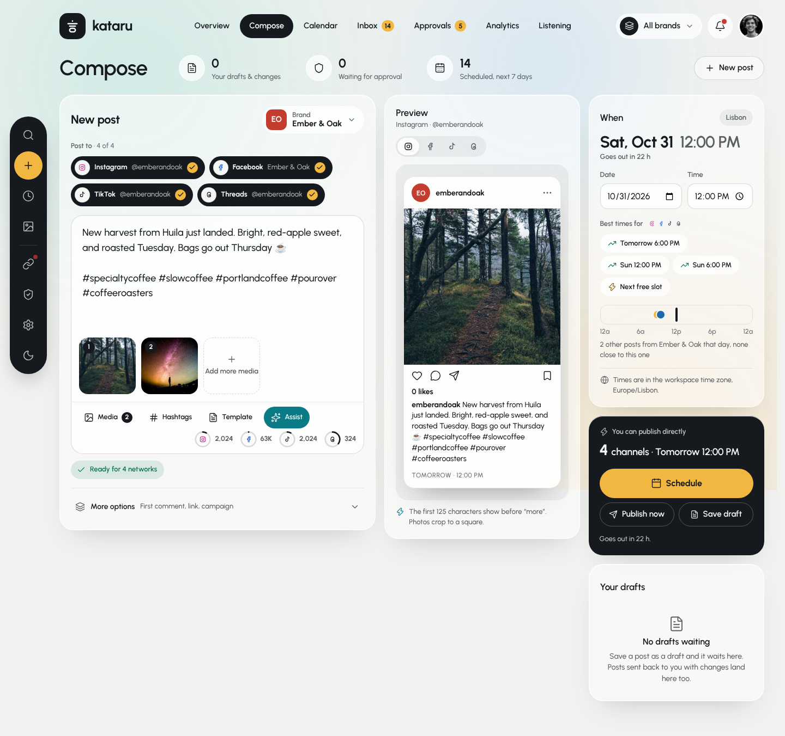 | 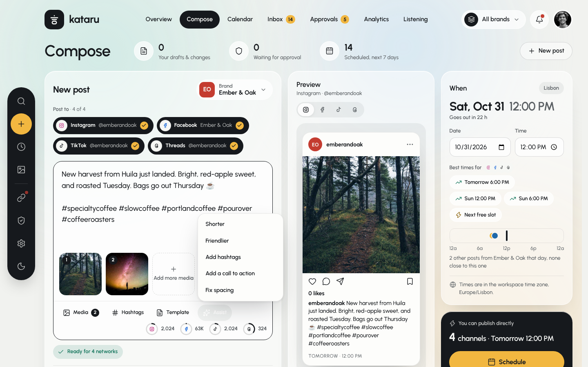 | 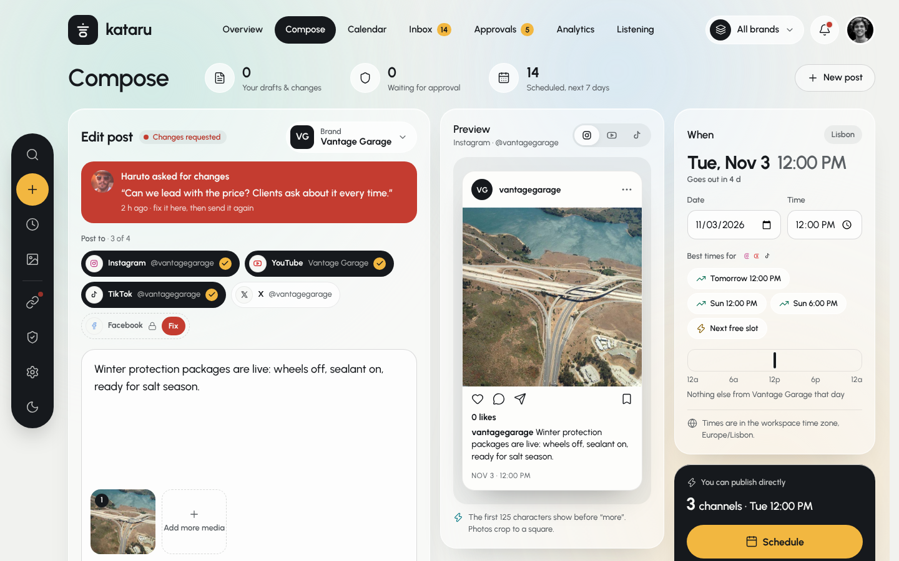 | 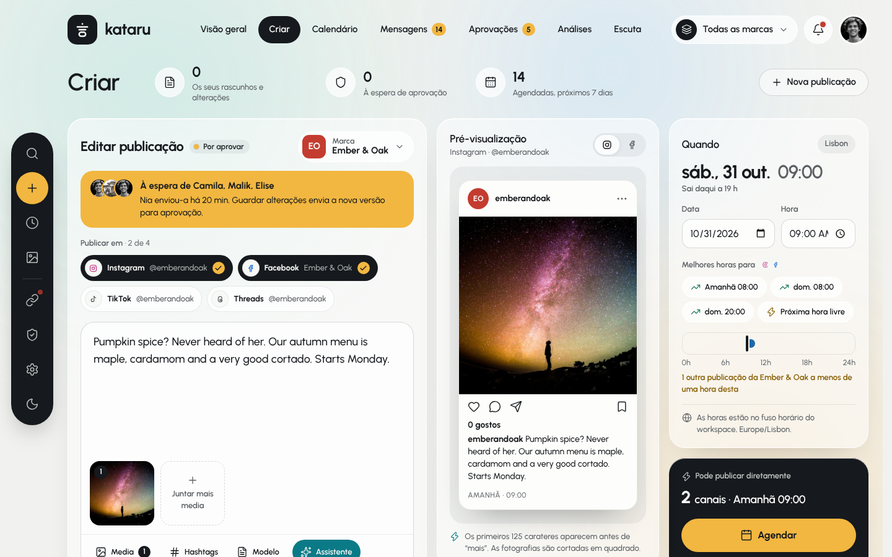 |

### Layout

```
header   title · 3 stats (your drafts & changes, waiting for approval, scheduled next 7 days) · New post (ghost)
.cm-grid editor 1.62fr | preview 1fr (sticky) | when / publish bar / your drafts 0.9fr, gap 16
         ≤ 1279px: editor | preview, then when | bar + drafts · ≤ 1000px: editor, preview | when + bar, drafts
         ≤ 760px: one column; the preview folds behind a toggle and the publish bar sticks above the bottom bar
```

| Part | Value |
| --- | --- |
| Brand picker | 50px pill (46 on phones), 38px brand mark, "Brand" 12.5px + name 15/700, chevron |
| Channel chips | 42px pills, 28px network disc on `--float`, name 700 + handle muted; on = ink with a 20px butter tick; expiring = butter dot; disconnected = dashed with a lock and a coral **Fix** (admins) |
| Text box | r22, `--line-2` border (text on focus), 18px / 1.55 text, min 220px, grows to 62vh; photos as 104px tiles numbered in order with remove / move buttons; tools row: Media (count), Hashtags, Template, **Assist** (lilac); 32px dials per network (butter from 80%, coral over) |
| Issues | 34px chips: coral blockers ("Instagram needs a photo", "N characters over X's limit", "Pick a time in the future", "That link looks incomplete"), butter warnings (access expiring), or pine "Ready for 4 networks" |
| More options | first comment (Instagram only), link (+ utm_source / medium / campaign, copy / insert), campaign |
| Preview | segmented network icons, r22 stage on `--well` (min 380px), the network's own layout ("Instagram needs a photo" placeholder), a tip per network |
| When | 30px "Sat, Oct 31 · 12:00 PM" + "Goes out in 22 h", date and time fields (47px), best times + Next free slot chips, a 36px day bar with the brand's other posts and a marker, the time-zone line |
| Publish bar | ink card: "You can publish directly" / "Goes through approval" (+ who can approve), "4 channels · Tomorrow 12:00 PM", 54px butter **Schedule** / Send for approval, Publish now, Save draft, "1 thing to fix before it can go" |
| Your drafts | your changes requested, failed and drafts ("To finish"), then waiting for approval; 3px status stripe, delete; empty state |

### Rules (`src/data/compose.ts`)

| Rule | Behaviour |
| --- | --- |
| Limits | Instagram 2,200 · Facebook 63,206 · X 280 (links count 23) · LinkedIn 3,000 · TikTok 2,200 · YouTube 5,000 · Pinterest 500 · Threads 500; Instagram and Pinterest need a photo, TikTok and YouTube a video or photo carousel |
| Best times | the selected networks' engagement heatmaps (the analytics ones) averaged per weekday × hour from 7 AM to 10 PM; the highest cells mapped onto the coming week, more than an hour away and four hours apart; earliest first |
| Default time | the earliest of the five best times not within an hour of the brand's other posts, else the next free slot (from an hour away, on the half hour, in 30-minute steps) — Sat, Oct 31 · 12:00 PM for Ember & Oak, with Tomorrow 6 PM, Sun 12 PM and Sun 6 PM suggested, as in the reference |
| Who publishes | the workspace rule (`perm`: roles without "Publish without approval" send posts to approvers; `all`: everyone but owners and admins) |
| Assist | rule-based rewrites: shorter (fillers, wordy phrases, contractions, two sentences, under 240), friendlier (warmer words + a greeting + the brand's emoji), the brand's hashtag set, a call to action in the brand's voice (with the link when there is one), spacing and capitals; each one undoable |

Saving adds the post (draft, scheduled, published, or waiting for approval with a
"submitted" review), logs it in the team activity ("scheduled “…” for Nov 1 ·
12:00 PM") and toasts with **View** for new posts. Editing a post shows why it's
there: who asked for changes and their note, who it waits on, when it's
scheduled, or that a published post is read-only (Open post, Duplicate).

### Data

From the reference state: each post's photos (up to 2 in the mock), campaign,
creation time and review trail (40 submissions, 33 approvals, 2 sent back with a
note); the nine posts scheduled for Nov 9–12; the 12 team members (an analyst, two
clients and a pending invite join the eight) and the seven roles with their 15
permissions; workspace settings; caption templates, hashtag sets and photo tags,
stars and sizes. The inbox still offers only people who can reply, and report
recipients are those who can see analytics, so those lists are unchanged.

### Verification

| Check | Result |
| --- | --- |
| 27 landmarks (header, five cards, brand, chips, text box, tools, Assist, dials, issues, more options, preview stage and card, when figure, best time chip, day bar, publish buttons) at **1440**, **1280**, **960** and **390** px (touch) | identical to the pixel |
| Default time, suggested times, "14 scheduled, next 7 days", the day-bar note | identical |
| 33 interaction checks (issues, photos and their order, Assist + undo, hashtag set, best time, link tagging, draft → edit → schedule, notes on changes-requested / pending / scheduled / published posts, unknown post, `?at=`, heatmap plan link, brand switch, activity feed) | all pass, no console errors |
| pt-PT, 7 states at 1440 and 390 px | no English left, nothing clipped |
| English text of the other pages | unchanged apart from the placeholder's route list |

Known differences: the reference also keeps an unsaved post per person and offers
to restore it, lets photos be dragged to reorder (here: move buttons) and animates
the dials and the day marker; role locks for other people are modelled (who
publishes directly, who approves) but the mock user is the owner.


## 14. Approvals (`#/approvals`)

Reached from the **Approvals** tab (its badge counts what waits on you), the dock's
shield, "Review" / "View" in the overview's *Needs you* and the composer's
"Goes through approval". Inspected the same way: computed styles at 1440 / 1280 /
960 / 390 px, the page's `approvals-*` CSS and JS read for behaviour and wording
only, and the reference's own state for the review trails.

| Approvals · 1440 | Two selected | Request changes |
| --- | --- | --- |
| 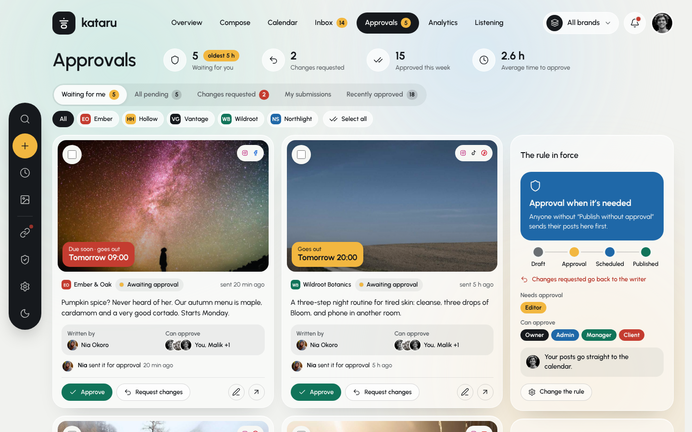 | 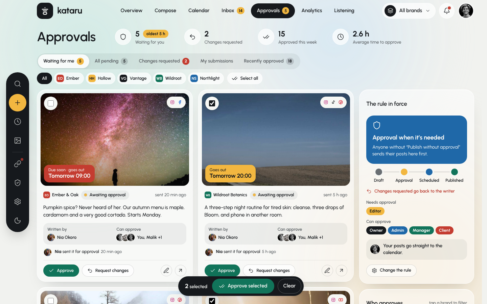 | 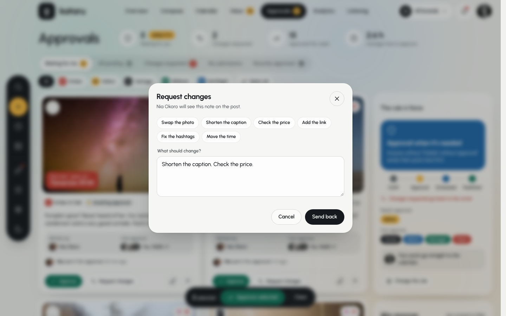 |

| Dark | Phone | pt-PT |
| --- | --- | --- |
| 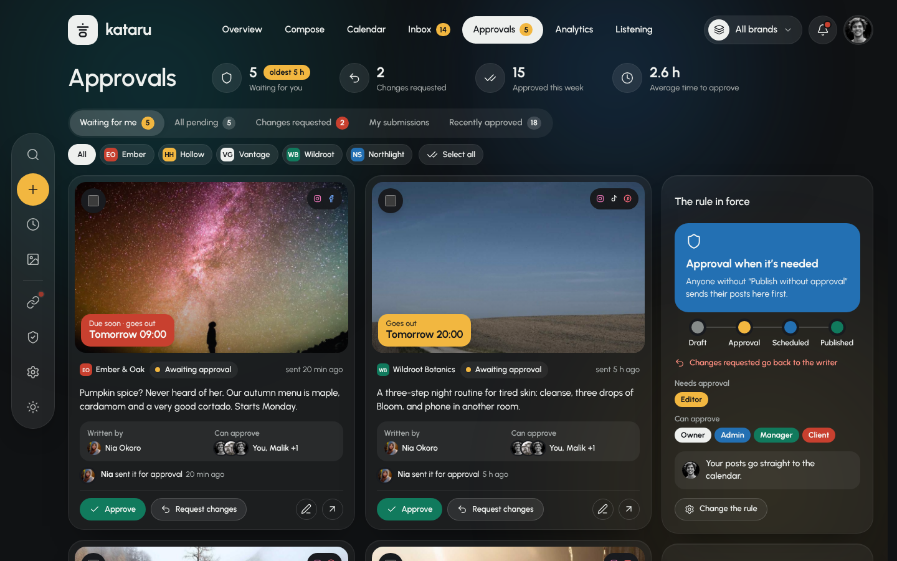 | 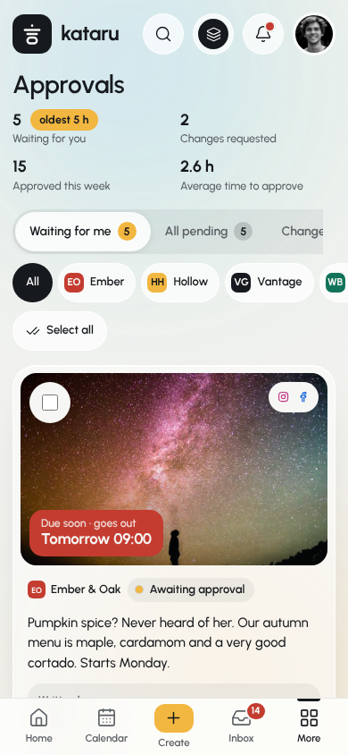 | 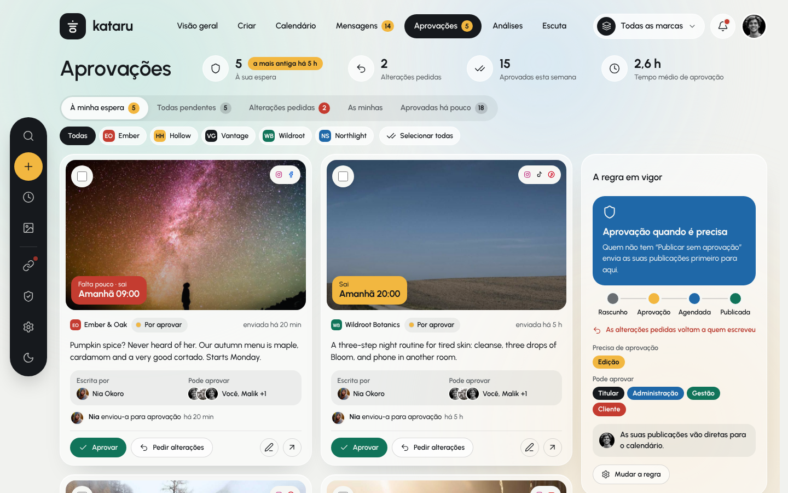 |

### Layout

```
header   title · 4 stats (waiting for you + "oldest 5 h", changes requested, approved this week, average time to approve)
toolbar  5 tabs with counts (butter = mine, coral = changes) · brand chips · Select all
grid     cards (auto-fill, min 340px, gap 16) | aside 340px (300px ≤ 1240px; below the cards, 2 columns, ≤ 1060px)
         phones: one column, the first six cards then "Show N more"; tabs and brand chips scroll sideways
```

| Part | Value |
| --- | --- |
| Tabs | `--well` track, 41px pills (44 on touch), counts 21px; butter for *Waiting for me*, coral for *Changes requested* |
| Brand chips | 34px (44 on touch), 22px brand mark, first word of the name; *All* and the picked one in ink |
| Card | r28 glass card, 274px photo (r20) with a dot per photo, 18px select box, the networks, and a "Goes out / Due soon · goes out / Was due / Went out" badge (butter, coral within a day); brand + status pill + "sent 20 min ago"; text clamped to 2 lines; *Written by* / *Can approve* (you first, "You, Malik +1"); the latest review step (earlier ones folded); Approve · Request changes (icon only under 400px) · Edit · Withdraw to drafts (your own) · Open post |
| Stamp | approving shows a pine "Approved" stamp for 650 ms (none with reduced motion) before the card leaves |
| The rule in force | the workspace rule as a blue tile (Approval when it's needed / Every post is approved / Approvals are off), the draft → approval → scheduled → published path with the "changes go back to the writer" loop, the roles that need and give approval, what it means for you, *Change the rule* (admins) |
| Who approves | one row per brand: approvers' avatars, "3 can approve · 2 waiting"; a row filters the page by that brand |
| Bulk bar | fixed ink pill: "2 selected", **Approve selected**, Clear; only posts you may review can be picked |
| Request changes | `<dialog>` with six quick notes that append to the note, a required textarea ("Say what should change.") and **Send back** |

### Rules (`src/data/approvals.ts`)

| Rule | Behaviour |
| --- | --- |
| Who reviews | anyone with "Approve posts" who sees the brand, never on their own post |
| Queues | *Waiting for me*: awaiting posts you may review · *All pending* · *Changes requested* · *My submissions* (yours, awaiting or sent back) · *Recently approved* (approved in the last 14 days, newest first); all others soonest first |
| Figures | *waiting* = your queue, *oldest* = its earliest submission; *approved this week* and *average time to approve* come from every post's review trail (submitted → next approval) |
| Approve | scheduled at its time; if that is less than 10 min away it moves to the next half hour an hour out; logged as "approved “…”" (or "approved N posts"), Undo |
| Send back | status *changes requested* with the note, shown on the post in the composer and in *Needs you* for the writer |
| Withdraw | back to drafts with a note in the trail, Undo |

The overview's *Needs you* is no longer a fixed list: it is built from the same
data — posts waiting on you (three, soonest first), your posts sent back, failed
posts, channels that lost access and unhappy conversations nobody (or you) owns —
so it reads exactly as before with the mock and changes as you act. **Approve**
works in place, **Review** opens the post drawer, **Retry** publishes again to the
channels still connected (or points to Channels when none are), and **Reconnect**
opens an "Authorise on YouTube" dialog that brings the channel back.

| Needs you → Reconnect |
| --- |
| 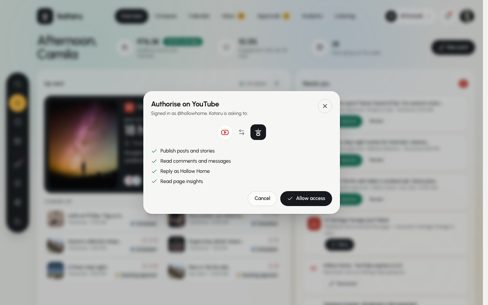 |

### Verification

| Check | Result |
| --- | --- |
| 25 landmarks (title, stats, tabs, brand chips, Select all, three cards and the first card's photo, badge, meta, text, people, history, actions, Approve; the rule card, its tile, path and roles; who approves) at **1440**, **1280**, **960** and **390** px (touch) | identical to the pixel |
| Figures and counts: 5 waiting (oldest 5 h), 2 sent back, 15 approved this week, 2.6 h average; tabs 5 / 5 / 2 / – / 18; who approves per brand | identical |
| 40 interaction checks (approve + stamp + undo, request changes with the required note and quick notes, bulk approve + undo, empty state, brand filter, every tab, drawer, overview approve / review / retry / reconnect, phone "Show 12 more", no sideways scroll at 1100 / 1000 / 390 px) | all pass, no console errors |
| pt-PT: five tabs, the dialog, bulk bar, overview and the authorise dialog at 1440 and 390 px | no English left, nothing clipped |
| English text of the other pages | unchanged (the overview included) |

Known differences: the reference animates the card leaving the grid; here it
leaves after the stamp without a reflow animation.

## 15. Saved state, Reset demo data and dialogs

The reference keeps its whole workspace in one `localStorage` entry, written
after every change and trusted only when its version and seed match; the
account menu's **Reset demo data** asks first ("Every change you made here goes
back to the starting data. Your theme stays."), resets in place without a
reload, keeps whoever is signed in and says "Demo data reset". Kataru does the
same with its own code (`src/data/persist.ts`, `src/data/store.tsx`):

| | Behaviour |
| --- | --- |
| Key | `kataru-workspace`: `{ version, seed, clock, workspace }`; nothing is written until something changes |
| When | 250 ms after the last change, and on `pagehide` |
| Which saves count | the same `version` and the same starting data: `seed` is an FNV-1a fingerprint of the mock, so a build with different mock data starts fresh instead of reading fields that aren't there; unreadable JSON is ignored |
| Clock | the mock clock is saved with the data and resumes from there, so a post approved "5 min ago" doesn't move into the future after a reload; the clock counts whole seconds |
| Other tabs | a save from another tab replaces this tab's data (`storage` event) without being written back |
| Reset | back to the mock, keeping the signed-in person; theme, language and the GA4 settings stay (they are per-browser settings); written at once so other tabs follow; toast "Demo data reset" |
| No storage | private windows or blocked storage: everything works, changes last for the visit |

| Account menu | Reset demo data? | A dialog on a phone |
| --- | --- | --- |
| 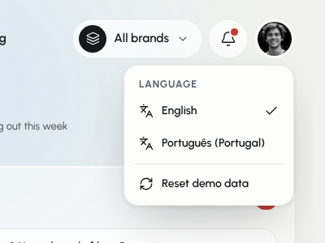 | 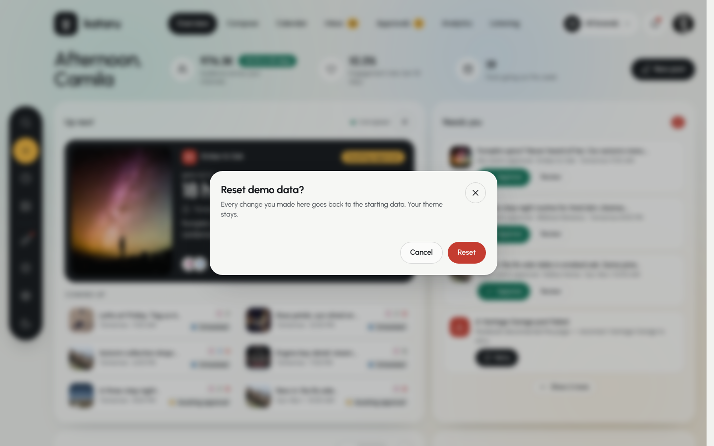 | 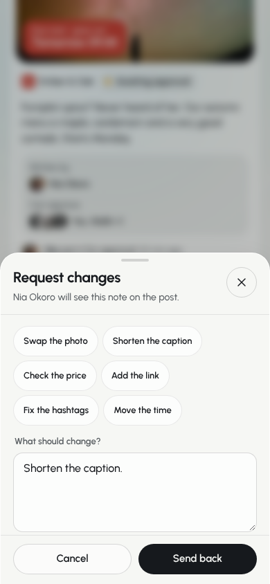 |

Measuring the reset confirmation showed that every dialog shares one frame in
the reference (`.modal` + `.mform`), and that ours had drifted from it. All
dialogs now use the same frame (`src/components/Modal.tsx`):

| Part | Desktop (from 761px) | Phone (≤ 760px) |
| --- | --- | --- |
| Box | 580px (`min(580px, 100% − 38px)`), r28 | bottom sheet: full width, 28px top corners, no bottom border, up to 92dvh, 40×4 handle 8px from the top |
| Header | title 21px / 1.45, −0.015em; sub 14px / 1.45, 4px above; 42px close; 18px below | fixed: 20 / 18 / 14px padding, a line below |
| Fields | 14px apart; text fields 46px | scroll between header and buttons, 16 / 18 / 4px padding |
| Error line | always 18px tall, 10px above the buttons, so the dialog doesn't jump when an error appears | shown only when there is one |
| Buttons | right-aligned, 10px apart, 8px below the error line | fixed: a line above, 12 / 18 / 14px (+ safe area) padding, buttons share the width |

The dialogs themselves were brought in line at the same time: the report's
recipient rows are 50px with the legend right above them, *Track a keyword*
has 46px fields, *Request changes* a 16px / 1.45 note box and 14px chips on
touch screens, *Authorise on …* is 580px wide with 14px scopes, and their main
buttons have no icon, as in the reference. Validation messages ("Say what
should change.", "Pick at least one recipient.") use the error line.

### Verification

| Check | Result |
| --- | --- |
| Reset, Schedule a report, Track a keyword, Request changes and Authorise: every header, field, error line, footer and button at **1440** and **390** px | identical, apart from text widths where the reference says "Murmura" |
| 22 persistence checks: nothing saved until a change, saved after one, reload keeps it, clock saved and resumed ("sent 20 min ago" → "sent 50 min ago" with a save from 14:45), a second tab follows, menu items, confirm text, Cancel keeps data, Reset restores it (theme kept, toast, other tab too), saves from another seed or broken JSON ignored, works with storage blocked, pt-PT wording | all pass, no console errors |
| Approvals, Compose and Listening interaction suites | all pass |
| pt-PT: account menu, reset, request changes, track, report and authorise (with their errors) at 1440 and 390 px | no English left, nothing clipped |
| English text of 13 states | unchanged |

The rest of the account menu (switch account, keyboard shortcuts, Light / Dark
/ Match system, sign out) comes with the shell's remaining controls.

## 16. Shell: brand switcher, notifications, Today's queue, Create

The top bar and the dock's actions now work as in the reference.

| Brand switcher | Notifications | Today's queue | Create |
| --- | --- | --- | --- |
| 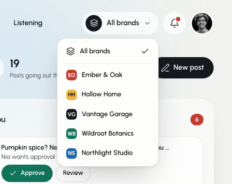 | 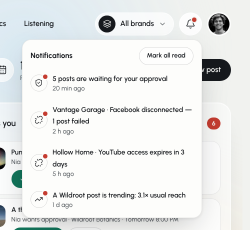 | 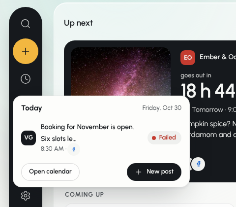 | 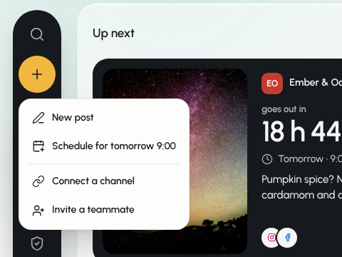 |

### Brand switcher

A menu (210px, 40px rows, 46px on touch) with *All brands* — *All my brands*
for someone who sees only some — and one row per brand with its 22px mark. The
choice applies to **every page**, as in the reference: posts, channels,
conversations, campaigns, keywords and mentions, competitors, websites and the
library follow it (`src/data/scope.ts`), as do the brands someone's role lets
them see. People, roles, settings and the activity log don't. It is saved
with the workspace and toasts "Showing Ember & Oak" / "Showing every brand".
The button shows the brand's 38px mark and name.

| With one brand in view | Behaviour (as the reference) |
| --- | --- |
| Overview | every figure for that brand (Ember & Oak: 142.7K, +8.5%, 11.5%); empty days in the week ahead show a dashed **Gap** |
| Calendar | "4 posts · 1 brand"; an upcoming empty day reads **Gap** with its coral dot (past ones *Free*) |
| Approvals | the brand chips go away |
| Analytics | "Ember & Oak · last 30 days", no *Brand comparison* (the grid closes up, `.an-grid--brands` only with several brands) |
| Listening | keyword rows drop the brand mark |

Analytics history is kept per network for all brands, with exact 7/30/90-day
totals per account. For one brand, each network's daily series is rescaled
window by window so those totals come out exact (Ember & Oak: +11.1K followers
in 30 days, 1.57M impressions, the per-network table to the digit); the daily
curve and "vs the 30 days before" are estimates from the network's shape
(−6.9% here, −7.6% in the reference). Demo website traffic is generated from
the whole workspace, so a site's numbers don't change with the switcher.

Two definitions were aligned with the reference on the way: *Posts going out
this week* counts scheduled and pending posts in the next seven days, and
*Inbox pulse* lists the three latest open conversations, read or not.

### Notifications

360px panel: "Notifications" and *Mark all read* (disabled when nothing is
unread), then rows with a 34px icon (44 on touch) chosen by where they lead —
approvals, channels, analytics, inbox, calendar — a coral dot while unread, the
text and "20 min ago". Opening one marks it read and goes there; "You're all
caught up." when empty. The reference's four start the list ("5 posts are
waiting for your approval", "Vantage Garage · Facebook disconnected — 1 post
failed", "Hollow Home · YouTube access expires in 3 days", "A Wildroot post is
trending: 3.1× usual reach"). New ones arrive as in the reference: sending a
post for approval tells its approvers, approving it or asking for changes tells
the writer (`src/data/notices.ts`). They are stored as data and worded in the
current language.

### Today's queue and Create

**Today's queue** (dock clock; *Today* in the phone's More sheet): today's
posts that aren't drafts, soonest first, with brand mark, the first 42
characters, time and networks, and status; a row opens the post drawer (now
available from anywhere). *Open calendar* and *New post* below.

**Create** (dock +, the phone bar's Create): *New post*, *Schedule for tomorrow
9:00* (the composer at that time), *Connect a channel*, *Invite a teammate* —
each disabled without the permission it needs.

### Verification

| Check | Result |
| --- | --- |
| Brand menu, notifications, Today's queue, Create at 1440 and 390 px (touch): panel and every row | identical (Today's queue within 1px) |
| Every page's text with Ember & Oak picked, against the reference | inbox, approvals and listening identical; overview, calendar and analytics identical apart from the estimates above, the countdown's second and the calendar's campaign dates |
| 21 interaction checks (menu, toast, scoped pages, saved across reloads, notices read one by one and all at once, a notice for the writer of an approved post, Today's queue → drawer, Create → composer at 9:00, phone More → Today) and the approvals, compose, listening and persistence suites | all pass, no console errors |
| pt-PT: the four panels and the scoped pages at 1440 and 390 px | no English left, nothing clipped |
| English text of 13 states with every brand | unchanged |
